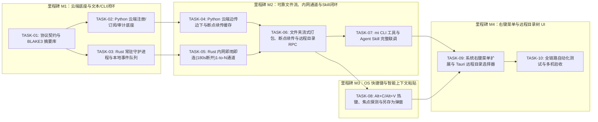

# 跨设备云端协同与剪贴板/文件同步系统 — 优先级评估与落地计划 (IMPLEMENTATION_PLAN)

---

## 1. 需求优先级多维评估 (Priority Assessment)

基于 **[REQUIREMENTS.md (v6)](./REQUIREMENTS.md)** 的完整功能范围，从**技术底座依赖度（Dependency）**、**核心业务价值（Business Value）**、**实现复杂度（Complexity）**与**可测性（Testability）**四个维度对全部 16 项功能需求进行优先级分层：

### 1.1 优先级分层原则

* **Tier 1 — `P0-Foundation`（核心底座与信令闭环，必须最先交付）**：
  * 共享通信契约、BLAKE3 摘要模型、Python 云端注册/订阅管理/事件分发总线、Rust 客户端守护服务骨架与本地事件队列、CLI 基础命令。
  * *评估依据*：所有上层文件传输、快捷键、右键菜单均依赖该通信与状态底座；同时 CLI 先行可让研发与 AI 智能体在无 GUI 阶段即可100%自动化联调。
* **Tier 2 — `P0-Transfer`（可靠文件流传输、内网即用即连与断点续传，核心硬骨头）**：
  * Python 云端内嵌“边传边下（Stream Teeing）”缓存池、Rust 客户端内网即用即连 `1-to-N` 双向通道（空闲满 `180 秒` 自动关闭）、分块与全文 `BLAKE3` 摘要校验、`Upload-Offset`/`Range` 双向断点续传、文件夹流式 `.tar.zst` 打包解包、远程目录查询 RPC 与定向同步 CLI。
  * *评估依据*：解决大文件与多层级文件夹跨机传输的可靠性与性能问题；此阶段完成后，`multinteractor` Skill 已可完整工作。
* **Tier 3 — `P0/P1-OS-Hotkey`（操作系统快捷键 `Alt+C`/`Alt+V` 与焦点感知粘贴）**：
  * 全局热键监听、当前活动窗口选中项抓取（文本/文件/文件夹）、焦点窗口类型识别（编辑器光标注入 vs Explorer/Finder 当前路径直写 vs 系统原生保存框兜底）。
  * *评估依据*：实现人工日常高频操作的核心交互闭环。
* **Tier 4 — `P1/P2-ContextMenu & UI`（系统鼠标右键【同步到... >】、远程目录树弹窗与扩展体验）**：
  * 操作系统 Shell 右键扩展菜单注册、Tauri v2 远程目录树懒加载选择弹窗（含远程新建文件夹）、传输进度悬浮窗、富文本/截图扩展与全量审计报表。

---

### 1.2 需求优先级与排期映射总表

| 优先级层级 | 需求编号 | 功能模块 | 核心交付内容 | 技术风险 | 归属里程碑 |
| :--- | :--- | :--- | :--- | :--- | :--- |
| **P0 (Tier 1)** | `FR-SRV-01` | Python 云端服务 | 客户端注册鉴权、内网 IP 映射表、Topic 订阅管理 | 低 | **M1** |
| **P0 (Tier 1)** | `FR-DAEMON-01`| Rust 客户端服务 | 后台常驻服务骨架、云端 WebSocket 保活重连、本地 IPC 服务 | 低 | **M1** |
| **P0 (Tier 1)** | `FR-COPY-02` | 本地事件缓存队列 | 订阅端接收事件环形队列（Ring Buffer，容量 50 条） | 低 | **M1** |
| **P0 (Tier 1)** | `FR-TRANS-02` | 摘要校验 (基础) | 文本与单文件全文 `BLAKE3` 摘要计算与校验 | 低 | **M1** |
| **P0 (Tier 2)** | `FR-SRV-03` | 云端边传边下缓存 | 内嵌 `StreamTeeCache`、一写多读实时分流、24h TTL 与配额清理 | **高** | **M2** |
| **P0 (Tier 2)** | `FR-TRANS-01` | 内网按需双向通道 | 即用即连 `1-to-N` 双向通道、通道复用、**空闲满 180 秒自动关闭** | **高** | **M2** |
| **P0 (Tier 2)** | `FR-TRANS-03` | 全链路断点续传 | `4 MB` 分块摘要、`Upload-Offset` 续传、`Range` 下载续传、跨通道续传 | **高** | **M2** |
| **P0 (Tier 2)** | `FR-SKILL-01` | CLI 与 Agent Skill| `mi` 命令行工具全指令集与 `.agents/skills/multinteractor` 联调 | 中 | **M1 / M2** |
| **P1 (Tier 2)** | `FR-SRV-02` | 云端日志审计 | SQLite WAL 三类审计日志（连接、事件、传输与校验）及查询 API | 低 | **M1 / M2** |
| **P0 (Tier 3)** | `FR-COPY-01` | `Alt+C` 复制广播 | 全局热键 `Alt+C`、Explorer/Finder 选中文件路径与编辑器选中文本提取 | **高** | **M3** |
| **P0 (Tier 3)** | `FR-PASTE-01~03`| `Alt+V` 智能粘贴 | 全局热键 `Alt+V`、焦点窗口识别、编辑器粘贴、文件夹直写、另存为弹窗 | **高** | **M3** |
| **P1 (Tier 4)** | `FR-CTX-01~03`| 右键【同步到...】 | 系统右键菜单注册、远程目录树懒加载 UI 弹窗、远程新建文件夹、静默落盘 | 中 | **M4** |
| **P2 (Tier 4)** | `FR-PASTE-02+`| 富媒体与体验增强 | 富文本（HTML/RTF）、剪贴板内存截图同步、文件冲突策略弹窗 | 低 | **M4** |

---

## 2. 分阶段落地里程碑计划 (Phased Milestones)

### 2.1 任务执行原子性与防冲突机制 (Task Atomicity & Conflict Prevention)

为确保多阶段任务严格按依赖顺序推进、避免多任务并发修改导致代码覆盖或状态不一致，本工程实施由 [`scripts/task_guard.py`](./scripts/task_guard.py) 与 `.task_lock.json` 驱动的四重原子控制机制：

1. **单活动任务互斥锁（Single-Active-Task Mutex）**：同一时刻全局仅允许唯一任务处于 `🔄 IN_PROGRESS` 状态；任何新任务在调用 `task_guard.py acquire <TASK_ID>` 时，若存在未释放锁的活动任务则立即阻断（`CONFLICT BLOCKED`）。
2. **DAG 前置依赖强校验（DAG Precondition Gate）**：启动任一任务前自动校验其 `depends_on` 列表中的所有前置任务必须为 `✅ COMPLETED`，严禁跳步执行。
3. **目录作用域排他隔离与快照（Scope Isolation & Pre/Post Hash Snapshot）**：每个任务绑定严格的允许修改目录列表（`locked_scopes`），加锁时记录目录内所有文件的 SHA-256 快照（`pre_snapshot`），完成时记录变更后快照（`post_snapshot`）。
4. **验证门禁原子提交（Verify-Then-Commit）**：仅当 `task_guard.py complete <TASK_ID> --verify "<test_cmd>"` 的自动化准出测试返回码为 `0` 时，才原子写入 `.task_lock.json`（通过 `.tmp` + `os.replace` 保证落盘原子性）并释放锁。

#### 任务实时执行状态与作用域锁总表 (Live Execution Status Board)

| 任务编号 | 任务名称 | 里程碑 | 前置依赖 | 实时执行状态 |
| :--- | :--- | :---: | :--- | :--- |
| **`TASK-01`** | 定义跨端协议契约与核心协议库 (`mi-protocol`) | **M1** | 无 | ✅ `COMPLETED` (已完成) |
| **`TASK-02`** | 实现云端客户端管理、Topic 订阅路由与 SQLite 日志审计 | **M1** | `TASK-01` | ✅ `COMPLETED` (已完成) |
| **`TASK-03`** | 实现客户端常驻守护进程 (`mi-daemon`) 与本地事件缓存列表 | **M1** | `TASK-01`, `TASK-02` | ✅ `COMPLETED` (已完成) |
| **`TASK-04`** | 实现云端内嵌“边传边下”与分块断点续传缓存引擎 | **M2** | `TASK-02` | ✅ `COMPLETED` (已完成) |
| **`TASK-05`** | 实现客户端内网即用即连（180s 空闲断开）`1-to-N` 通道 | **M2** | `TASK-03` | ✅ `COMPLETED` (已完成) |
| **`TASK-06`** | 实现大文件全链路断点续传、文件夹流式打包解包与远程目录 RPC | **M2** | `TASK-04`, `TASK-05` | ✅ `COMPLETED` (已完成) |
| **`TASK-07`** | 实现 `mi` CLI 命令行工具与 `multinteractor` Skill 联调 | **M2** | `TASK-06` | ✅ `COMPLETED` (已完成) |
| **`TASK-08`** | 实现系统全局热键 `Alt+C`/`Alt+V`、焦点探测与智能粘贴/保存框兜底 | **M3** | `TASK-06` | ✅ `COMPLETED` (已完成) |
| **`TASK-09`** | 实现系统鼠标右键扩展菜单与远程目录选择器弹窗 (`mi-ui`) | **M4** | `TASK-07`, `TASK-08` | ✅ `COMPLETED` (已完成) |
| **`TASK-10`** | 全链路集成测试、故障注入验证与交付打包 | **M4** | `TASK-01` ~ `TASK-09` | ✅ `COMPLETED` (已完成) |

---

## 3. 工程任务拆解看板 (Task Breakdown Board)

每个任务均遵循单一职责、明确目录边界（`scope`）与可量化验收标准：

### 阶段一：M1 — 核心通信底座、订阅审计与文本闭环

#### `TASK-01`：定义跨端协议契约与核心协议库 (`mi-protocol`) [✅ COMPLETED]
* **负责模块**：`client/crates/mi-protocol` & `server/app/models.py`
* **优先级**：Tier 1 (`P0`) | **依赖**：无
* **工作内容**：
  1. 定义 `CloudEventEnvelope`（`v6`）、设备注册帧、Topic 订阅帧、远程目录查询 RPC（`FS_LIST_DIR_REQ/RESP`、`FS_MKDIR_REQ/RESP`）数据结构。
  2. 实现全文与 `4 MB` 固定分块 `BLAKE3` 摘要计算器（`DigestManifest`）及流式哈希校验器。
* **准出标准**：`cargo test -p mi-protocol` 与服务端 Schema 序列化/反序列化双向互通测试 100% 通过。

#### `TASK-02`：实现云端客户端管理、Topic 订阅路由与 SQLite 日志审计 [✅ COMPLETED]
* **负责模块**：`server/app/main.py`, `client_sub_manager.py`, `audit_logger.py`
* **优先级**：Tier 1 (`P0`) | **依赖**：`TASK-01`
* **工作内容**：
  1. 基于 `FastAPI` + `WebSocket` 实现客户端注册鉴权、心跳保活、在线设备与内网 `IP:Port` 列表实时同步。
  2. 实现 Pub/Sub 订阅管理器：支持广播主题（`topic.clipboard.broadcast`）与设备单播主题（`topic.sync.direct.<id>`、`topic.rpc.fs.<id>`）的精准路由。
  3. 基于 SQLite（WAL 模式）实现 `audit_connection_log`、`audit_event_log`、`audit_transfer_log` 三张审计表及 `GET /api/v1/audit/logs` 查询接口。
* **准出标准**：启动 3 个模拟 WebSocket 客户端连接服务端，设备上线/下线、订阅广播及 SQLite 审计日志记录全部准确无误。

#### `TASK-03`：实现客户端常驻守护进程 (`mi-daemon`) 与本地事件缓存列表 [✅ COMPLETED]
* **负责模块**：`client/crates/mi-daemon`
* **优先级**：Tier 1 (`P0`) | **依赖**：`TASK-01`, `TASK-02`
* **工作内容**：
  1. 实现与云端的单长连接自动重连与事件订阅监听。
  2. 实现本地接收事件缓存环形队列（`EventCacheList`，容量 50 条）及本地回环 IPC 接口（`127.0.0.1:53318`）。
  3. 打通纯文本广播、摘要校验与本地事件列表存取闭环。
* **准出标准**：节点 A 发送文本“人工智能”，节点 B、C 的 `EventCacheList` 在 `100ms` 内收到事件且 `BLAKE3` 校验通过。

---

### 阶段二：M2 — 边传边下缓存、内网即用即连（180s 断开）、断点续传与 Skill 联调

#### `TASK-04`：实现云端内嵌“边传边下”与分块断点续传缓存引擎 (`stream_tee_cache.py`) [✅ COMPLETED]
* **负责模块**：`server/app/stream_tee_cache.py`
* **优先级**：Tier 2 (`P0`) | **依赖**：`TASK-02`
* **工作内容**：
  1. 实现基于 `HEAD / PATCH` (`Upload-Offset`) 的分块断点上传接口，每写入一个分块校验 `X-Chunk-Blake3` 并更新内存水位线 `written_offset`。
  2. 实现基于 `asyncio.Condition` 的**边传边下（Stream Teeing）**读取流（`GET /api/v1/cache/{id}/stream`），支持 `Range: bytes=offset-` 断点下载。
  3. 实现 `BLAKE3` 相同哈希文件秒传复用（CAS）及后台 24 小时 TTL / 配额 LRU 自动清理协程。
* **准出标准**：模拟源端限速上传 `100 MB` 文件，上传至 `10%` 时目标端发起下载，目标端可实时边传边下直至 `100%` 并通过全文摘要校验。

#### `TASK-05`：实现客户端内网即用即连（`1-to-N` 并发 + `180 秒` 空闲延迟断开）双向通道 [✅ COMPLETED]
* **负责模块**：`client/crates/mi-daemon/src/lan_channel.rs`
* **优先级**：Tier 2 (`P0`) | **依赖**：`TASK-03`
* **工作内容**：
  1. 启动本地异步 TLS/WSS/HTTP2 监听端点，支持内网多台设备（`1-to-N`）同时按需连入并并发拉取文件流或查询目录。
  2. 实现连接池管理器（`LanChannelPool`）：平时保持零内网连接；当触发文件传输或远程目录查询时**即用即连**；通道绑定 `180 秒`（可配置）空闲计时器（`IdleTimer`），活跃期复用并重置计时，**空闲满 180 秒无数据交互后自动关闭释放连接**。
* **准出标准**：B、C 同时从 A 拉取文件时自动建立 `A<->B` 和 `A<->C` 通道并发完成传输；停止操作满 180 秒（测试环境可设为 5 秒加速验证）后套接字连接数自动归零。

#### `TASK-06`：实现大文件全链路断点续传、文件夹流式 `.tar.zst` 打包解包与远程目录 RPC [✅ COMPLETED]
* **负责模块**：`client/crates/mi-daemon/src/transfer/`, `fs_rpc.rs`
* **优先级**：Tier 2 (`P0`) | **依赖**：`TASK-04`, `TASK-05`
* **工作内容**：
  1. 实现下载端 `.multinteractor.part` + `.resume.json` 断点状态持久化，支持内网通道中断后无缝携带 `Range` 头切换至云端缓存通道继续续传。
  2. 基于 `async-tar` + `zstd` 实现多层级文件夹的边读边打包上传与接收端边下边解包还原（含防 `..` 路径穿越安全校验）。
  3. 实现响应远程目录查询（`LIST_DIR`，含盘符、剩余空间、快捷目录）与远程新建文件夹（`MKDIR`）处理器。
* **准出标准**：`500 MB` 文件传输中途断网或切换通道后可从断点继续完成且摘要 100% 一致；多级文件夹结构完整还原。

#### `TASK-07`：实现 `mi` CLI 命令行工具与 `multinteractor` Agent Skill 全链路联调 [✅ COMPLETED]
* **负责模块**：`client/crates/mi-cli` & `.agents/skills/multinteractor/SKILL.md`
* **优先级**：Tier 2 (`P0`) | **依赖**：`TASK-06`
* **工作内容**：
  1. 实现 `mi devices list`、`mi events list`、`mi copy`、`mi paste`、`mi remote-ls`、`mi remote-mkdir`、`mi sync`、`mi transfer status/resume` 全部子命令及 `--json` 结构化输出。
  2. 使用 AI 智能体按 `.agents/skills/multinteractor/SKILL.md` 执行跨机复制、远程目录浏览与定向同步验收。
* **准出标准**：全部 8 类 CLI 命令返回标准 JSON，AI 智能体可通过自然语言调用 Skill 完成跨设备文件同步。

---

### 阶段三：M3 — 操作系统快捷键 `Alt+C`/`Alt+V` 与上下文智能粘贴

#### `TASK-08`：实现系统全局热键、活动窗口选中项抓取与智能粘贴/保存对话框兜底 (`mi-os`) [✅ COMPLETED]
* **负责模块**：`client/crates/mi-os`
* **优先级**：Tier 3 (`P0`) | **依赖**：`TASK-06`
* **工作内容**：
  1. 注册全局快捷键 `Alt+C` 与 `Alt+V`（支持自定义配置）。
  2. 实现 `Alt+C` 上下文提取器：在 Explorer / Finder 窗口中直接提取当前选中的文件/文件夹路径列表；在常规编辑窗口中提取当前选中的文本/图片。
  3. 实现 `Alt+V` 智能粘贴路由器：
    * 若待粘贴事件为文本/图片且当前焦点在编辑器（Word / TXT / IDE），直接写入系统剪贴板并触发粘贴上屏；
    * 若待粘贴事件为文件/文件夹且当前焦点在文件资源管理器（Explorer / Finder），自动读取该窗口当前打开的物理目录路径并直接启动流式落盘；
    * 若当前焦点不在文件资源管理器窗口（无法确定目标目录），自动弹出系统原生**“另存为 / 选择保存目录”对话框**。
* **准出标准**：完整跑通口述场景“A 电脑 Word 按 `Alt+C` 复制‘人工智能’ $\rightarrow$ B 电脑按 `Alt+V` 粘贴”及“B 电脑按 `Alt+C` 复制 `AI教程.docx` $\rightarrow$ C 电脑文件夹按 `Alt+V` 直接落盘（或非文件夹窗口弹窗保存）”。

---

### 阶段四：M4 — 系统鼠标右键菜单【同步到... >】与远程目录树 UI

#### `TASK-09`：实现系统鼠标右键扩展菜单与远程目录选择器弹窗 (`mi-ui`) [✅ COMPLETED]
* **负责模块**：`client/crates/mi-os/src/context_menu.rs` & `client/crates/mi-ui`
* **优先级**：Tier 4 (`P1`) | **依赖**：`TASK-07`, `TASK-08`
* **工作内容**：
  1. 注册操作系统文件/文件夹右键菜单项 `【同步到... >】`（Windows 注册表 Shell 扩展 / macOS Finder Quick Action & Services），以及系统托盘剪贴板右键同步菜单。
  2. 开发轻量级**远程目录树选择器弹窗**：支持在线设备选择、按需懒加载展开目标机器目录树、显示目标盘符剩余空间、支持远程【新建文件夹】、以及大文件传输进度悬浮条。
* **准出标准**：右键点击任意文件/文件夹选择 `【同步到... > 电脑 C】`，200ms 内弹出电脑 C 目录树，选定目录确认后文件静默落盘至电脑 C 指定目录。

#### `TASK-10`：全链路集成测试、故障注入验证与交付打包 [✅ COMPLETED]
* **负责模块**：`tests/`
* **优先级**：Tier 4 (`P0`) | **依赖**：`TASK-01` ~ `TASK-09`
* **工作内容**：
  1. 严格按照 **[TEST_AND_ACCEPTANCE.md](./TEST_AND_ACCEPTANCE.md)** 执行全部功能、断点续传故障注入、180s 连接释放及安全边界测试。
  2. 输出跨平台客户端安装包与 Python 云端一键启动脚本。
* **准出标准**：所有 P0/P1 测试用例 100% 通过，无高危安全漏洞与句柄泄漏。
