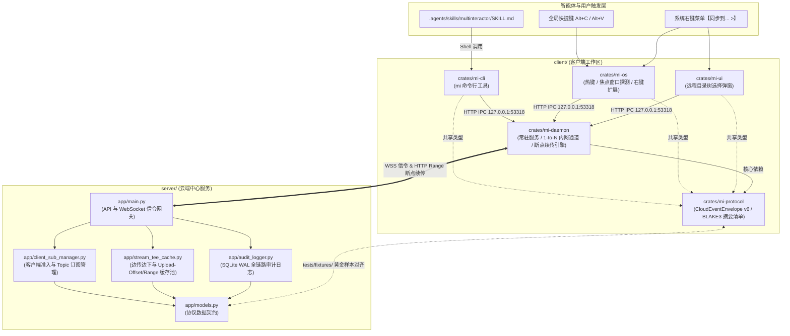

# 跨设备云端协同与剪贴板/文件同步系统 — 项目目录结构规范 (PROJECT_STRUCTURE)

---

## 1. 设计原则与工程组织目标 (Design Principles)

本规范依据 **[REQUIREMENTS.md (v6)](./REQUIREMENTS.md)**、**[IMPLEMENTATION_PLAN.md (v1)](./IMPLEMENTATION_PLAN.md)** 与 **[TEST_AND_ACCEPTANCE.md (v1)](./TEST_AND_ACCEPTANCE.md)** 制定，采用 **Monorepo 架构（云端单节点服务 `server/` + 客户端工作区 `client/` + 标准 Agent Skill `.agents/`）**，遵循以下四大核心原则：

1. **职责正交与单向依赖（Strict Layering & Unidirectional Dependency）**：
   * 客户端按“协议契约层 (`mi-protocol`) $\rightarrow$ 常驻守护与传输内核 (`mi-daemon`) $\rightarrow$ 交互触发层 (`mi-cli` / `mi-os` / `mi-ui`)”严格分层，严禁反向依赖或循环依赖。
   * 所有上层入口（全局热键 `Alt+C`/`Alt+V`、鼠标右键菜单、目录树弹窗、`mi` CLI 工具）均通过本地回环 IPC (`127.0.0.1:53318`) 与 `mi-daemon` 通信，确保单机仅维护唯一云端长连接与内网通道池。
2. **跨端协议单一事实来源（Single Source of Truth for Contracts）**：
   * `client/crates/mi-protocol` 与 `server/app/models.py` 严格对齐 `v6` 版 `CloudEventEnvelope`、分块 `BLAKE3` 摘要结构及断点续传 HTTP 头规范，并通过顶层 `tests/fixtures/` 中的黄金测试向量（Golden Vectors）保障序列化 100% 互通。
3. **平台无关内核与 OS 原生适配解耦（Core vs. Platform Isolation）**：
   * 网络传输、180 秒空闲自动断开连接池、断点续传、`.tar.zst` 流式打包等跨平台逻辑全部内聚在 `mi-daemon`；Windows 与 macOS 平台特定的窗口句柄探测、Explorer/Finder 选中路径读取、Shell 右键菜单扩展统一隔离在 `mi-os/src/platform/` 下。
4. **面向业务领域的目录命名与任务边界隔离（Domain-Oriented Naming & Task-Scoped Ownership）**：
   * 目录命名以业务职能与架构角色为准（如 `server/`、`client/`、`deploy/`、`tests/`），不耦合具体开发语言名称；目录边界与 `IMPLEMENTATION_PLAN.md` 中的 `TASK-01` ~ `TASK-10` 一一映射，支持并行开发且零文件冲突。

---

## 2. 仓库全局目录树总览 (Global Repository Tree)

```text
multinteractor/
├── REQUIREMENTS.md                          # [PRD/SRS] 需求规格说明书 (v6)
├── IMPLEMENTATION_PLAN.md                   # [PM] 优先级评估与分阶段工程落地计划 (v1)
├── TEST_AND_ACCEPTANCE.md                   # [QA] 测试金字塔与验收规格说明书 (v1)
├── PROJECT_STRUCTURE.md                     # [ARCH] 项目目录结构与模块边界规范 (本文档)
├── Makefile                                 # 统一构建、代码检查与联调测试入口
├── .gitignore                               # Git 忽略规则 (排除 target/, .venv/, *.part, *.resume.json 等)
│
├── .agents/                                 # AI 智能体扩展与技能目录
│   └── skills/
│       └── multinteractor/
│           └── SKILL.md                     # 供 AI 智能体调用的标准跨机协同 Skill 定义
│
├── server/                                  # 【云端服务端】客户端/订阅管理 + 边传边下缓存 + 日志审计
│   ├── pyproject.toml                       # 服务端依赖声明与打包配置
│   ├── README.md                            # 云端服务部署与配置说明
│   ├── app/                                 # 服务端核心源码包
│   │   ├── __init__.py
│   │   ├── main.py                          # 应用入口、生命周期管理与 WebSocket 信令网关
│   │   ├── config.py                        # 环境变量与配置加载 (端口、Token 密钥、24h TTL、10GB 配额)
│   │   ├── models.py                        # 协议数据模型 (对齐 CloudEventEnvelope v6 与 RPC 契约)
│   │   ├── client_sub_manager.py            # 客户端注册鉴权、在线状态/内网 IP 维护、Topic 订阅路由管理
│   │   ├── stream_tee_cache.py              # 内嵌式“边传边下 (Stream Teeing)”与 Upload-Offset/Range 断点续传缓存引擎
│   │   ├── audit_logger.py                  # SQLite WAL 全链路日志审计引擎 (连接/事件/传输三表) 与查询接口
│   │   └── api/                             # REST API 路由模块拆分
│   │       ├── __init__.py
│   │       ├── devices.py                   # 设备台账查询、Token 签发/吊销接口 (/api/v1/devices)
│   │       ├── cache.py                     # 分块断点上传 (HEAD/PATCH) 与流式下载 (GET Range) 接口 (/api/v1/cache)
│   │       └── audit.py                     # 审计日志多维检索接口 (/api/v1/audit/logs)
│   └── tests/                               # 服务端单元测试
│       ├── conftest.py
│       ├── test_client_sub_manager.py       # 注册准入与 Topic 订阅隔离测试
│       ├── test_stream_tee_cache.py         # 一写多读边传边下、分块 BLAKE3 校验与断点续传单元测试
│       └── test_audit_logger.py             # SQLite WAL 并发写入与审计检索测试
│
├── client/                                  # 【客户端工程】常驻守护服务 + 系统交互 + CLI + 目录弹窗
│   ├── Cargo.toml                           # Workspace 根配置及统一依赖版本锁定 ([workspace.dependencies])
│   ├── rust-toolchain.toml                  # 工具链版本声明 (stable)
│   └── crates/
│       ├── mi-protocol/                     # [模块 1: 协议与摘要核心库] 零 OS/IO 重依赖，纯数据契约与算法
│       │   ├── Cargo.toml
│       │   └── src/
│       │       ├── lib.rs
│       │       ├── envelope.rs              # CloudEventEnvelope (v6)、Topic、EventType 与设备元数据定义
│       │       ├── digest.rs                # 全文与 4MB 分块 BLAKE3 摘要计算器 (DigestManifest) 与流式校验器
│       │       ├── rpc.rs                   # 远程目录浏览 (FS_LIST_DIR)、远程建目录 (FS_MKDIR)、定向同步回执模型
│       │       ├── resume.rs                # 断点续传状态文件 (.multinteractor.resume.json) 数据结构
│       │       └── ipc.rs                   # 本地 Daemon <-> CLI/OS/UI 回环 IPC (127.0.0.1:53318) 请求/响应契约
│       │
│       ├── mi-daemon/                       # [模块 2: 本地常驻守护服务与传输内核]
│       │   ├── Cargo.toml
│       │   └── src/
│       │       ├── main.rs                  # 守护进程启动入口 (mi-daemon 二进制)
│       │       ├── lib.rs                   # Daemon 核心服务组装与生命周期控制
│       │       ├── config.rs                # 客户端配置管理 (云端 URL、Device Token、180s 空闲超时、本地监听端口)
│       │       ├── cloud_client.rs          # 云端常驻 WebSocket 信令客户端 (自动重连、订阅同步、内网 IP 上报)
│       │       ├── event_queue.rs           # 本地接收事件缓存环形队列 (EventCacheList，默认容量 50 条)
│       │       ├── lan_channel.rs           # 内网即用即连 1-to-N 双向通道池 (LanChannelPool + 180s 空闲自动关闭计时器)
│       │       ├── transfer/                # 可靠文件传输与全链路断点续传子模块
│       │       │   ├── mod.rs               # 传输任务调度器 (内网直连优先 -> 失败/中断自动降级云端缓存续传)
│       │       │   ├── uploader.rs          # 分块流式上传器 (HEAD 查偏移 + PATCH 4MB 分块续传 + 源文件变更检测)
│       │       │   ├── downloader.rs        # 断点续传下载器 (.part 写入 + Range 跨通道无缝续传 + 全文摘要转正)
│       │       │   └── archive.rs           # 文件夹流式 .tar.zst 边读边打包与边下边解包 (含防 .. 路径穿越安全拦截)
│       │       ├── fs_rpc.rs                # 远程文件系统 RPC 服务端 (ROOT 盘符探测、500ms 单层目录超时保护、远程 mkdir)
│       │       └── ipc_server.rs            # 本地 HTTP/IPC 服务端 (监听 127.0.0.1:53318，向 mi-cli/mi-os/mi-ui 暴露接口)
│       │
│       ├── mi-os/                           # [模块 3: 操作系统原生深度交互集成层]
│       │   ├── Cargo.toml
│       │   └── src/
│       │       ├── lib.rs                   # OS 交互代理入口
│       │       ├── hotkey.rs                # 全局快捷键监听引擎 (Alt+C 复制广播 / Alt+V 智能粘贴)
│       │       ├── capture.rs               # Alt+C 上下文抓取器 (自动识别活动窗口选中文本、图片或 Explorer/Finder 选中路径)
│       │       ├── smart_paste.rs           # Alt+V 智能粘贴路由器 (编辑器光标注入 vs 资源管理器直写 vs 另存为弹窗兜底)
│       │       ├── context_menu.rs          # 鼠标右键【同步到... >】扩展菜单注册与在线设备列表动态更新
│       │       ├── power.rs                 # 系统电源管理锁 (大文件上传期间短暂阻止系统合盖/自动休眠，防 RISK-02)
│       │       └── platform/                # 操作系统原生 API 适配层 (按 target_os 条件编译)
│       │           ├── mod.rs               # 统一平台抽象 Trait (OsWindowInspector, OsShellExtension, OsClipboard)
│       │           ├── windows.rs           # Windows 实现 (Win32 UIAutomation/COM 获取 Explorer 路径、注册表右键扩展)
│       │           └── macos.rs             # macOS 实现 (Accessibility API / AppleScript 获取 Finder 路径、Finder Quick Actions)
│       │
│       ├── mi-cli/                          # [模块 4: 命令行工具 (mi) — 赋能 Agent Skill 与自动化脚本]
│       │   ├── Cargo.toml                   # 生成二进制名称 `mi` (别名 `multinteractor`)
│       │   └── src/
│       │       ├── main.rs                  # 命令行参数解析与统一 `--json` 结构化输出格式化器
│       │       ├── client.rs                # 调用本地 mi-daemon (127.0.0.1:53318) 的轻量 IPC 客户端
│       │       └── commands/                # 对应 SKILL.md 的子命令实现
│       │           ├── mod.rs
│       │           ├── devices.rs           # `mi devices list --json`
│       │           ├── events.rs            # `mi events list [--limit N] --json`
│       │           ├── copy.rs              # `mi copy --text/--path --json`
│       │           ├── paste.rs             # `mi paste [--event-id] [--dest] --json`
│       │           ├── remote_fs.rs         # `mi remote-ls` & `mi remote-mkdir --json`
│       │           ├── sync.rs              # `mi sync --source --device --remote-dir --json`
│       │           └── transfer.rs          # `mi transfer status/resume --task-id --json`
│       │
│       └── mi-ui/                           # [模块 5: 轻量级远程目录树弹窗与状态面板]
│           ├── Cargo.toml
│           ├── tauri.conf.json              # 窗口配置 (无边框轻量弹窗、系统托盘常驻图标)
│           ├── src/                         # 宿主桥接层
│           │   ├── main.rs
│           │   └── commands.rs              # IPC Commands (桥接 mi-daemon 的远程目录懒加载与定向同步接口)
│           └── ui/                          # 前端轻量视图资源 (HTML/TypeScript/CSS)
│               ├── index.html
│               ├── directory_picker.ts      # 【同步到... >】远程目录树懒加载选择器 + 远程新建文件夹交互
│               └── transfer_toast.ts        # 大文件传输进度悬浮条与断点续传状态提示
│
├── tests/                                   # 【全链路集成、故障注入与多机验收测试套件】
│   ├── fixtures/                            # 共享测试夹具与黄金样本
│   │   ├── envelope_v6_golden.json          # CloudEventEnvelope v6 标准序列化测试样本 (供双端双向校验)
│   │   ├── blake3_vectors.json              # 全文与 4MB 分块 BLAKE3 标准测试向量
│   │   └── generate_malicious_tar.py        # 构造含 `../../` 路径穿越条目的恶意 .tar.zst 样本生成器 (用于 TC-NFR-03)
│   ├── integration/                         # L2：Client Daemon <-> Cloud Server 协议互通与边传边下集成测试
│   │   ├── test_signaling_and_audit.py      # 对应 TC-SRV-01 ~ TC-SRV-03
│   │   └── test_stream_teeing_pipeline.py   # 对应 TC-RES-01 ~ TC-RES-02
│   ├── chaos/                               # L3：网络故障注入与混沌测试
│   │   ├── test_resumable_transfer.py       # 对应 TC-RES-03 ~ TC-RES-05 (断网续传、内网切云端续传、比特翻转重传)
│   │   └── test_lan_idle_disconnect.py      # 对应 TC-LAN-01 ~ TC-LAN-02 (1-to-N 并发与 180 秒空闲自动断开验证)
│   └── e2e/                                 # L4：端到端 CLI / Agent Skill / OS 模拟验收测试
│       ├── test_cli_and_skill_workflow.py   # 对应 TC-SKILL-01
│       └── test_clipboard_and_sync_e2e.py   # 对应 AC-01 ~ AC-04 完整业务流验证
│
└── deploy/                                  # 【部署配置与服务自启动模板】
    ├── server/
    │   ├── Dockerfile                       # 云端单节点容器镜像构建文件
    │   ├── docker-compose.yml               # 一键启动云端服务 (挂载 SQLite 审计库与流式缓存卷)
    │   └── multinteractor-hub.service       # Linux Systemd 服务单元模板
    └── client/
        ├── windows/
        │   └── install_service_and_menu.ps1 # Windows 后台服务注册与右键菜单【同步到...】注册表安装脚本
        └── macos/
            └── com.multinteractor.daemon.plist # macOS LaunchAgent 常驻自启动配置
```

---

## 3. 组件依赖关系与架构边界图 (Module Dependency Graph)



---

## 4. 核心子系统目录职责与关键文件规范 (Detailed Subsystem Specifications)

### 4.1 云端服务端 (`server/`)

定位为**个人单节点轻量云端中枢**，不引入 Redis/MinIO 等外部重型组件，所有状态由内存异步结构 + SQLite WAL + 本地文件系统流式缓存池承载：

| 目录 / 文件路径 | 对应需求与任务 | 核心职责与设计约束 |
| :--- | :--- | :--- |
| `app/models.py` | `TASK-01` | 严格定义 `CloudEventEnvelope`（`spec_version="v6"`）、`DigestInfo`（含 `full_hash`、`chunk_size_bytes=4194304`、`chunk_hashes`）、设备注册帧与远程目录 RPC 消息格式。 |
| `app/client_sub_manager.py` | `FR-SRV-01`<br/>`TASK-02` | 维护在线客户端连接表、设备内网 `lan_endpoint (IP:Port)` 映射、以及 Topic 订阅路由表（`topic.clipboard.broadcast`、`topic.sync.direct.<id>`、`topic.rpc.fs.<id>`、`topic.system.presence`）。 |
| `app/stream_tee_cache.py` | `FR-SRV-03`<br/>`TASK-04` | 管理 `{cache_dir}/{file_cache_id}.part`：处理 `HEAD` 查询偏移、`PATCH` 追加写入并校验 `X-Chunk-Blake3`；实现一写多读**边传边下（Stream Teeing）**，支持 `Range: bytes=offset-` 断点拉取及 24h TTL 自动清理。 |
| `app/audit_logger.py` | `FR-SRV-02`<br/>`TASK-02` | 初始化 SQLite `WAL` 模式数据库，管理 `audit_connection_log`、`audit_event_log`、`audit_transfer_log` 三张核心表，提供异步非阻塞写入队列与多维查询能力。 |

---

### 4.2 客户端工作区 (`client/crates/`)

划分为 5 个独立子模块（Crates），确保编译速度最优化与模块边界清晰：

#### （1）`crates/mi-protocol` — 协议与摘要底座
* **设计约束**：纯数据结构与纯计算库，**禁止依赖操作系统的 UI、窗口或网络监听库**，以便被所有其他子模块快速引用。
* **核心能力**：
  * `envelope.rs`：定义跨端事件信封与序列化逻辑。
  * `digest.rs`：提供针对内存字节流、单文件以及流式数据块的全文 `BLAKE3` 哈希与 `4 MB` (`4,194,304 bytes`) 分块哈希计算与校验函数。
  * `resume.rs`：定义 `<filename>.multinteractor.resume.json` 的读写格式与块级校验位图。

#### （2）`crates/mi-daemon` — 本地常驻服务与可靠传输引擎
* **设计约束**：随系统启动的无界面后台守护进程（Service/Daemon），空闲内存控制在 `<= 30 MB`。
* **核心能力**：
  * `lan_channel.rs`：实现**内网即用即连与 180 秒空闲自动断开机制**。平时维护 `0` 条内网连接；当触发文件拉取或目录浏览时按需建立 `1-to-N` 双向通道；每个通道绑定独立的 `IdleTimer(180s)`，有任何数据帧收发即重置计时器，满 180 秒无交互自动优雅关闭套接字。
  * `transfer/`：统一调度内网直连与云端缓存双通道。下载文件时先写入 `<filename>.multinteractor.part`，若内网通道中断，自动读取已通过分块校验的 `verified_offset`，携带 `Range: bytes=<verified_offset>-` 无缝切换至云端缓存池继续拉取，全文 `BLAKE3` 校验通过后执行原子重命名。
  * `transfer/archive.rs`：处理多层级文件夹流式 `.tar.zst` 打包与解包，内置路径安全检查器（强制拒绝包含 `..` 或绝对路径的归档条目）。
  * `fs_rpc.rs`：响应远端发来的 `FS_LIST_DIR_REQ` 与 `FS_MKDIR_REQ`，内置 `500ms` 浅层目录读取超时保护（防止休眠机械硬盘阻塞，应对 `RISK-03`）。

#### （3）`crates/mi-os` — 操作系统原生交互层
* **设计约束**：通过 `src/platform/{windows.rs, macos.rs}` 封装平台差异，向上暴露统一的跨平台接口。
* **核心能力**：
  * `hotkey.rs` & `capture.rs`：监听 `Alt+C`，若当前焦点在资源管理器（Windows Explorer / macOS Finder）则直接获取选中文件/文件夹路径；若在编辑器则获取选中文本/图片，交由 `mi-daemon` 广播。
  * `smart_paste.rs`：监听 `Alt+V`，读取本地事件缓存队列最新项并探测当前活动窗口类型：
    1. 文本/图片 + 编辑器焦点 $\rightarrow$ 校验摘要后直接注入剪贴板并模拟粘贴上屏；
    2. 文件/文件夹 + Explorer/Finder 焦点 $\rightarrow$ 获取当前打开的目录路径并通知 `mi-daemon` 直接流式落盘；
    3. 文件/文件夹 + 非文件管理器窗口 $\rightarrow$ 弹出系统原生**【另存为 / 选择保存目录】对话框**。
  * `context_menu.rs`：管理系统右键菜单 `【同步到... >】` 扩展项，点击后拉起 `mi-ui` 远程目录选择器。

#### （4）`crates/mi-cli` — 智能体与命令行接口 (`mi`)
* **设计约束**：极速启动的无状态二进制程序（编译产物名为 `mi`），所有子命令均通过请求本地 `http://127.0.0.1:53318/api/v1/*` 执行，并严格遵循 `.agents/skills/multinteractor/SKILL.md` 定义的 `--json` 输出格式。

#### （5）`crates/mi-ui` — 轻量级图形弹窗
* **设计约束**：仅用于渲染系统原生对话框无法覆盖的**远程目录树懒加载选择器（【同步到... >】弹窗）**与传输进度条，平时不驻留重型视图进程（按需唤起窗口）。

---

## 5. 运行时数据与临时文件目录规范 (Runtime Data & File Conventions)

为保证生产环境与测试环境的数据隔离、审计可追溯以及异常中断后的干净恢复，运行时产生的文件遵循以下路径规范：

### 5.1 云端服务端运行时目录 (`~/.multinteractor-server/` 或 `/var/lib/multinteractor/`)

```text
/var/lib/multinteractor/                     # 可通过环境变量 MI_SERVER_DATA_DIR 覆盖
├── config.toml                              # 服务端持久化配置
├── db/
│   ├── audit.db                             # SQLite 审计与客户端/订阅数据库 (开启 WAL 模式)
│   ├── audit.db-wal                         # SQLite Write-Ahead Log
│   └── audit.db-shm                         # SQLite Shared Memory
└── stream_cache/                            # 边传边下与断点续传缓存池目录 (默认配额 10GB, TTL 24h)
    ├── fc_20261105_99887766.part            # 正在流式上传中 (STREAMING) 的缓存文件 (支持边传边下)
    ├── fc_20261105_99887766.meta.json       # 缓存元数据 (total_size, written_offset, full_blake3, chunk_hashes)
    └── fc_20261105_11223344.cache           # 已上传完成并通过全文摘要校验 (COMPLETED) 的缓存文件
```

### 5.2 客户端本地配置与日志目录

| 操作系统 | 客户端配置与运行状态目录 | 说明 |
| :--- | :--- | :--- |
| **Windows** | `%APPDATA%\multinteractor\` | 存放 `client.toml`、本机设备证书/Token、本地接收事件快照及运行日志 `daemon.log` |
| **macOS** | `~/Library/Application Support/multinteractor/` | 同上 |
| **Linux** | `~/.config/multinteractor/` | 同上 |

### 5.3 目标目录文件接收与断点续传临时文件命名规范

当目标设备接收文件（例如 `AI教程.docx`）至目标目录 `D:\Target\` 时，严禁直接创建同名正式文件，必须遵循**“临时文件写入 + 断点元数据伴随 + 摘要校验后原子转正”**规范：

```text
D:\Target\
├── AI教程.docx.multinteractor.part          # [传输中] 已接收字节数据流，按 4MB 分块校验追加写入
├── AI教程.docx.multinteractor.resume.json   # [传输中] 记录 file_cache_id, verified_offset, full_hash, chunk_hashes
└── AI教程.docx                              # [传输完成] 仅当全文 BLAKE3 校验 100% 一致后，由 .part 原子重命名生成并删除 .resume.json
```

---

## 6. 里程碑任务 (`TASK-01` ~ `TASK-10`) 与目录映射速查表

研发人员或 AI 智能体在执行 **[IMPLEMENTATION_PLAN.md](./IMPLEMENTATION_PLAN.md)** 中的具体任务时，应严格在对应的目录边界（Scope）内创建和修改代码：

| 任务编号 | 任务名称 | 归属里程碑 | 允许修改的代码目录范围 (`Scope`) | 配套测试目录 |
| :--- | :--- | :--- | :--- | :--- |
| **`TASK-01`** | 跨端协议契约与 `BLAKE3` 摘要库 | **M1** | `client/crates/mi-protocol/`<br/>`server/app/models.py` | `tests/fixtures/` |
| **`TASK-02`** | 云端客户端注册、订阅路由与 SQLite 审计 | **M1** | `server/app/main.py`<br/>`server/app/client_sub_manager.py`<br/>`server/app/audit_logger.py`<br/>`server/app/api/{devices,audit}.py` | `server/tests/`<br/>`tests/integration/test_signaling_and_audit.py` |
| **`TASK-03`** | 客户端常驻守护进程与本地事件缓存列表 | **M1** | `client/crates/mi-daemon/src/{main,lib,config,cloud_client,event_queue,ipc_server}.rs` | `client/crates/mi-daemon/tests/` |
| **`TASK-04`** | 云端边传边下与断点续传缓存引擎 | **M2** | `server/app/stream_tee_cache.py`<br/>`server/app/api/cache.py` | `server/tests/test_stream_tee_cache.py`<br/>`tests/integration/test_stream_teeing_pipeline.py` |
| **`TASK-05`** | 内网即用即连（180s 空闲断开）`1-to-N` 通道 | **M2** | `client/crates/mi-daemon/src/lan_channel.rs` | `tests/chaos/test_lan_idle_disconnect.py` |
| **`TASK-06`** | 全链路断点续传、`.tar.zst` 流式打包与远程目录 RPC | **M2** | `client/crates/mi-daemon/src/transfer/`<br/>`client/crates/mi-daemon/src/fs_rpc.rs` | `tests/chaos/test_resumable_transfer.py` |
| **`TASK-07`** | `mi` CLI 工具与 `multinteractor` Skill 联调 | **M2** | `client/crates/mi-cli/`<br/>`.agents/skills/multinteractor/SKILL.md` | `tests/e2e/test_cli_and_skill_workflow.py` |
| **`TASK-08`** | 全局热键 `Alt+C`/`Alt+V`、焦点探测与智能粘贴 | **M3** | `client/crates/mi-os/src/{hotkey,capture,smart_paste,power,platform}.rs` | `tests/e2e/test_clipboard_and_sync_e2e.py` |
| **`TASK-09`** | 系统右键菜单【同步到... >】与远程目录树弹窗 | **M4** | `client/crates/mi-os/src/context_menu.rs`<br/>`client/crates/mi-ui/` | `tests/e2e/test_clipboard_and_sync_e2e.py` |
| **`TASK-10`** | 全链路集成测试、故障注入验证与交付打包 | **M4** | `tests/`<br/>`deploy/`<br/>`Makefile` | `tests/{integration,chaos,e2e}/` |
