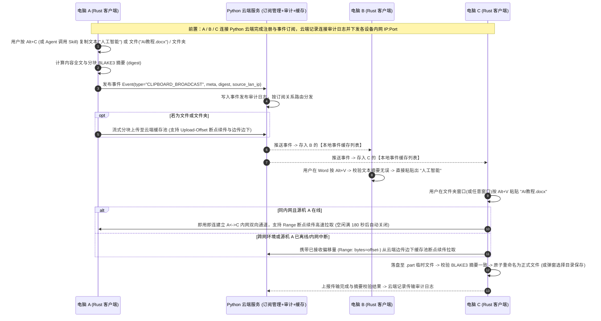
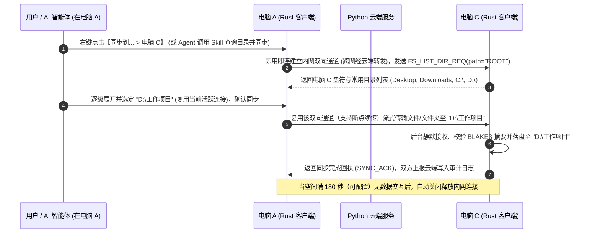

# 跨设备云端协同与剪贴板/文件同步系统 — 需求规格说明书

---

## 1. 引言与项目概述 (Introduction)

### 1.1 业务背景与产品目标
在个人多设备办公与研发场景中，用户常同时使用多台计算机设备（如台式机 A、办公笔记本 B、测试机 C），需要在不同设备间高频传递文本、图片、文件及多层级文件夹，同时希望 AI 智能体（Agent）也能通过标准技能（Skill）自动执行跨机文件与剪贴板协同。

本系统（`multinteractor`）旨在提供一套**个人专属、系统服务常驻、支持快捷键/右键菜单/AI 智能体三端触发、具备端到端摘要校验与断点续传能力**的多机数据协同解决方案，核心目标如下：
1. **Python 云端服务（客户端与订阅管理 + 日志审计 + 边传边下缓存）**：A / B / C 设备注册连接至 Python 云端单节点服务器，由服务端统一管理客户端准入、事件频道订阅关系、全链路操作审计日志以及临时文件流式缓存。
2. **Rust 客户端常驻服务与多维触发**：
   * **`Alt+C` / `Alt+V` 快捷键**：通过 `Alt+C` 复制并触发广播，订阅设备接收事件并缓存在本地事件列表；通过 `Alt+V` 自动识别待粘贴内容类型与当前焦点窗口环境，在编辑器直接粘贴文本/图片、在文件资源管理器直接粘贴文件/文件夹，或弹出保存对话框。
   * **鼠标右键【同步到... >】**：动态按需拉取目标机器的文件目录结构，将剪贴内容、文件或文件夹直接同步至目标机器的指定目录。
   * **Skill / 智能体原生调用**：Rust 客户端提供结构化 CLI 与本地 IPC/HTTP 接口，配套专用 Agent Skill（`multinteractor`），支持智能体直接查询设备、拉取远程目录、发送/粘贴文本与文件。
3. **内网即用即连（180 秒空闲延迟断开）+ 全链路摘要校验与断点续传**：
   * 内网设备间平时不维持网状常驻连接，触发传输或目录查询时根据云端下发的内网 IP **即用即连**建立双向通道（支持一对多 `1-to-N` 多机并发），**当空闲满 180 秒（可配置）无数据交互后自动关闭释放连接**；
   * 所有传输内容强制执行 **全文与分块摘要校验（BLAKE3 / SHA-256）**，并支持上传与下载双向**断点续传**。

### 1.2 术语与定义 (Glossary)

| 术语 / 缩略语 | 完整名称 | 定义与说明 |
| :--- | :--- | :--- |
| **Cloud Hub (Python)** | Python 云端中心服务 | 负责客户端注册管理、Pub/Sub 订阅路由、内嵌流式缓存及 SQLite 日志审计的单节点服务端 |
| **Event Cache List** | 本地接收事件缓存列表 | 订阅设备收到广播事件后在本地维护的环形事件队列，供 `Alt+V` 或智能体读取粘贴 |
| **Stream Teeing** | 边传边下流式分流机制 | 源设备上传文件流至云端时，云端一边落盘本地缓存文件，一边将已收到的字节流实时转发给正在拉取的目标设备 |
| **On-Demand LAN Channel** | 内网即用即连双向通道 | 仅在产生数据传输或远程目录浏览需求时按需建立的内网双向连接，空闲满 180 秒后自动断开释放 |
| **Resumable Transfer** | 偏移量断点续传 | 基于 `Upload-Offset` 与 HTTP `Range` 的分块续传机制，支持网络闪断或通道切换后从已写入字节偏移量处继续传输 |

---

## 2. 系统总体架构设计 (System Architecture)

### 2.1 系统分层架构图

```mermaid
flowchart TB
    subgraph Cloud["个人云端服务器 (Python FastAPI + Asyncio + SQLite)"]
        SubMgr["客户端与订阅管理模块<br/>(设备注册鉴权 / 在线状态 / Topic订阅关系)"]
        Broker["Pub/Sub 异步事件分发总线<br/>(WebSocket / Asyncio Queue)"]
        StreamCache["内嵌式边传边下与断点续传缓存引擎<br/>(分块追加写入 + Range读取 + TTL清理)"]
        AuditLog["日志审计中心 (SQLite WAL)<br/>(设备连接审计 / 事件投递审计 / 传输与校验审计)"]
    end

    subgraph ClientA["设备 A (Rust 客户端：常驻服务 + UI + Agent 接口)"]
        A_Trigger["触发层：<br/>1. 全局热键 (Alt+C)<br/>2. 系统右键【同步到... >】<br/>3. Agent Skill / CLI (mi)"]
        A_DirUI["远程目录树选择器弹窗"]
        A_Daemon["Rust 本地常驻服务 (client-daemon)<br/>摘要计算(BLAKE3) / 断点续传引擎 / 按需内网双向通道端(1-to-N)"]
    end

    subgraph ClientBC["设备 B / C (Rust 客户端：常驻服务 + UI + Agent 接口)"]
        C_Daemon["Rust 本地常驻服务 (client-daemon)<br/>按需内网双向通道端 / 断点续传与摘要校验器"]
        C_Queue["本地接收事件缓存列表<br/>(Event Cache Ring Buffer)"]
        C_Execute["执行层 (Alt+V / 定向同步 / Skill调用)：<br/>1. 编辑器粘贴文本/图片<br/>2. 资源管理器直接落盘文件/目录<br/>3. 弹出另存为对话框<br/>4. 定向目录静默写入"]
    end

    A_Trigger --> A_Daemon
    A_Trigger --> A_DirUI
    A_Daemon <-->|1. 常驻信令长连接：注册/订阅/内网IP同步| Broker
    C_Daemon <-->|1. 常驻信令长连接：注册/订阅/内网IP同步| Broker
    Broker --> SubMgr
    Broker --> AuditLog

    A_Daemon <-.->|2. 内网双向通道：即用即连 + 空闲满180秒自动关闭 (支持 1-to-N 并发)| C_Daemon

    A_Daemon ===>|3A. 断点续传上传 + 摘要校验| StreamCache
    StreamCache ===>|3B. 边传边下 / Range断点续传下载| C_Daemon
    StreamCache --> AuditLog
```

---

### 2.2 端到端核心业务流程

#### 流程一：`Alt+C` / Skill 复制广播与 `Alt+V` 智能粘贴（含断点续传与摘要校验）


#### 流程二：鼠标右键【同步到... >】或 Agent Skill 定向目录同步


---

## 3. 功能性需求规格 (Functional Requirements)

### 3.1 需求优先级评估矩阵

> **优先级评估准则**：
> * **P0 (Core Foundation & Data Pipeline)**：核心通信底座、数据安全（摘要与断点续传）、基础复制粘贴闭环及 CLI/Skill 接口，决定系统能否跑通核心业务。
> * **P1 (OS Native Experience & Direct Sync)**：操作系统深度交互集成（全局热键焦点感知、系统右键菜单扩展、远程目录树 UI 弹窗与全量审计查询），决定日常交互体验。
> * **P2 (Enhancement & Polish)**：富媒体格式扩展、历史事件回溯面板、自定义冲突弹窗等增强特性。

| 需求编号 | 模块名称 | 功能点名称 | 优先级 | 落地阶段 |
| :--- | :--- | :--- | :--- | :--- |
| **FR-SRV-01** | Python 云端服务 | 客户端注册准入、在线状态维护与订阅关系管理（Subscription Management） | **P0** | M1 |
| **FR-SRV-02** | Python 云端服务 | 全链路日志审计系统（连接审计、事件订阅分发审计、文件传输与校验审计） | **P1** | M1 / M2 |
| **FR-SRV-03** | Python 云端服务 | 内嵌式“边传边下（Stream Teeing）”文件缓存池与 TTL/配额自动清理 | **P0** | M2 |
| **FR-TRANS-01** | 可靠传输与内网通道 | 内网即用即连双向通道（支持一对多 `1-to-N` 并发，空闲满 `180 秒` 自动关闭释放） | **P0** | M2 |
| **FR-TRANS-02** | 可靠传输与内网通道 | 传输内容摘要校验（全文 + 分块 `BLAKE3` 校验，不一致自动重传） | **P0** | M1 / M2 |
| **FR-TRANS-03** | 可靠传输与内网通道 | 全链路断点续传（支持上传续传、下载 `Range` 续传、以及内网中断无缝切云端续传） | **P0** | M2 |
| **FR-DAEMON-01**| Rust 客户端服务 | 后台守护服务（Service）与用户态交互代理（Agent）常驻运行 | **P0** | M1 |
| **FR-SKILL-01** | 智能体与 Skill 集成 | Rust 客户端提供 CLI (`mi`) / 本地 IPC 接口，配套标准 Agent Skill 供智能体直接调用 | **P0** | M1 / M2 |
| **FR-COPY-02** | 本地事件缓存队列 | 订阅端接收事件并缓存在本地事件列表（支持历史回溯） | **P0** | M1 |
| **FR-COPY-01** | `Alt+C` 复制与广播 | 全局快捷键 `Alt+C` 上下文抓取（选中文本/图片/文件/文件夹）并触发广播 | **P0** | M3 |
| **FR-PASTE-01** | `Alt+V` 智能粘贴 | 全局快捷键 `Alt+V` 自动识别事件内容类型与当前焦点窗口类型 | **P0** | M3 |
| **FR-PASTE-02** | `Alt+V` 智能粘贴 | 文本在 TXT/Word/编辑器区域直接粘贴（P0）；富文本/内存截图扩展支持（P2） | **P0 / P2** | M3 / M4 |
| **FR-PASTE-03** | `Alt+V` 智能粘贴 | 文件/文件夹在文件资源管理器直接粘贴落盘，或自动弹出保存对话框 | **P0** | M3 |
| **FR-CTX-02** | 远程目录树动态拉取 | 按需动态拉取目标机器文件目录结构（懒加载展开 + 远程新建文件夹） | **P1** | M2 (RPC) / M4 (UI) |
| **FR-CTX-03** | 定向目录静默投递 | 将剪贴内容/文件/文件夹直接同步落盘至目标机器指定目录 | **P1** | M2 (CLI) / M4 (UI) |
| **FR-CTX-01** | 右键菜单【同步到...】| 操作系统右键扩展菜单集成与在线目标机器列表展示 + 远程目录选择弹窗 | **P1** | M4 |

---

### 3.2 各模块详细功能规格

#### 3.2.1 Python 云端服务端：客户端与订阅管理 + 日志审计 + 边传边下缓存 (`FR-SRV`)

1. **客户端与订阅管理 (`FR-SRV-01`)**：
   * **客户端管理**：维护已注册设备台账（`device_id`、设备别名、操作系统、首次/最后在线时间、内网 `IP:Port`、设备启用/禁用状态），提供轻量 REST 管理接口（及简洁 Web 状态页）查看在线客户端、签发/吊销客户端访问 Token。
   * **订阅管理（Pub/Sub Topic Subscription）**：
     * 支持客户端按事件主题（Topic）动态订阅或取消订阅（默认自动订阅：`topic.clipboard.broadcast` 跨机复制广播、`topic.sync.direct.<device_id>` 定向目录投递、`topic.rpc.fs.<device_id>` 远程目录查询、`topic.system.presence` 设备状态通知）。
     * 支持按设备配置订阅过滤规则（例如某台设备仅订阅文本事件、或仅接收特定设备的推送）。
2. **日志审计系统 (`FR-SRV-02`)**：
   * 基于 SQLite（WAL 高并发模式）与结构化 JSON 日志，持久化记录三类核心审计表，并提供按时间、设备、事件类型检索的审计查询接口（`GET /api/v1/audit/logs`）：
     * **设备连接审计 (`audit_connection_log`)**：记录设备注册、上线、下线、鉴权失败、IP 变更事件。
     * **事件投递审计 (`audit_event_log`)**：记录每一次广播或定向事件的 `event_id`、发起设备、订阅接收设备列表、内容类型（文本/文件/文件夹）、内容摘要（`content_hash`）及字节大小。
     * **文件传输与校验审计 (`audit_transfer_log`)**：记录文件上传/下载进度、所走通道（内网直连 / 云端缓存）、是否发生断点续传（续传偏移量与次数）、最终接收端摘要校验结果（`VERIFIED_OK` / `HASH_MISMATCH`）。
3. **内嵌“边传边下”文件缓存池 (`FR-SRV-03`)**：
   * 采用 Python `asyncio` + `aiofiles` 管理本地缓存目录：源设备上传文件流时顺序写入 `{file_cache_id}.part` 并更新内存偏移量水位线 `written_offset`（通过 `asyncio.Condition` / `Event` 唤醒等待协程），允许目标设备在源设备尚未上传完成时**实时边传边下（Stream Teeing）**。
   * 源设备离线后，已上传完成的缓存文件保留默认 **24 小时（TTL 可配置）**，支持其他设备随时异步拉取。

---

#### 3.2.2 传输内容摘要校验与全链路断点续传 (`FR-TRANS-02` & `FR-TRANS-03`)

1. **双重摘要校验机制（Digest Verification）**：
   * **全文摘要（Whole-Payload Digest）**：
     * 文本/图片：计算字节流的 `BLAKE3` 摘要随事件信封下发，接收端写入剪贴板前校验摘要。
     * 单文件/文件夹：源设备计算文件的 `BLAKE3` 摘要（文件夹在流式打包 `.tar.zst` 的同时计算流摘要及内部各文件摘要清单 `manifest`）。接收端下载完毕后对 `.part` 临时文件重新计算 `BLAKE3`，**必须与事件信封中的 `content_hash` 严格一致**，才允许原子重命名（Atomic Rename）为正式文件或解包落盘；若校验失败，立即丢弃损坏分块并触发自动重传。
   * **分块摘要（Chunk-level Digest）**：
     * 针对大于 `4 MB` 的文件，按固定 `4 MB` 分块计算 `chunk_hashes` 列表。每接收完一个 `4 MB` 分块即刻校验该块摘要，一旦发现单块传输比特翻转损坏，仅需重传该 `4 MB` 分块，无需重传整个大文件。
2. **全链路双向断点续传机制（Resumable Transfer）**：
   * **断点续传上传（源端 $\rightarrow$ 云端缓存）**：
     * 源端上传文件支持分块追加协议（`PATCH /api/v1/cache/{file_cache_id}`，请求头携带 `Upload-Offset: <byte_offset>` 与 `Content-Digest: blake3=<chunk_hash>`）。
     * 若网络中断，源端重连后先调用 `HEAD /api/v1/cache/{file_cache_id}` 获取云端已落盘确认的 `Upload-Offset`，直接从断点位置继续上传剩余分块。
   * **断点续传下载（目标端 $\leftarrow$ 内网双向通道 / 云端缓存）**：
     * 目标端接收文件时，在目标目录维护 `<filename>.multinteractor.part` 数据文件与 `<filename>.multinteractor.resume.json` 状态文件（记录 `file_cache_id`、`total_size`、`verified_offset`、`content_hash`）。
     * **支持跨通道无缝续传**：若目标端通过内网双向通道下载某 `1 GB` 文件至 `600 MB` 时源设备突然关闭或内网断开，目标端自动携带 `Range: bytes=629145600-` 切换至云端缓存通道（或待内网重连后），直接从 `600 MB` 偏移量处继续拉取剩余 `400 MB` 数据！

---

#### 3.2.3 内网即用即连与 180 秒空闲延迟断开双向通道 (`FR-LAN-01` & `FR-LAN-02`)
1. **平时零内网连接，触发即用即连**：
   * 内网多台机器在空闲状态下不维护网状常驻连接。仅当触发 `Alt+V` 拉取文件或右键 `【同步到... >】` 浏览远程目录/同步文件时，根据云端同步的目标机内网 `IP:Port` 立即建立双向连接。
2. **支持一对多（`1-to-N`）多机并发传输**：
   * 允许内网多台机器同时与一台机器建立内网双向通道并并发收发数据流。
3. **连接复用与 180 秒空闲自动断开**：
   * 已建立的内网通道在连续操作期间直接复用并重置空闲计时器；**当空闲满 `180 秒`（可配置）无数据交互后，自动关闭释放连接**。

---

#### 3.2.4 Rust 客户端常驻服务、`Alt+C`/`Alt+V` 与右键菜单 (`FR-DAEMON` ~ `FR-CTX`)
1. **常驻服务 + `Alt+C` 复制广播**：
   * 后台服务随系统启动常驻；用户按 `Alt+C` 时抓取当前选中的文本、图片、文件或文件夹，计算 `BLAKE3` 摘要后发布广播事件，订阅设备将其缓存在**本地接收事件列表**中。
2. **`Alt+V` 自动识别与智能粘贴**：
   * **粘贴文本/图片**：焦点在 TXT/Word/编辑器区域时直接粘贴到光标处；焦点在文件夹窗口时支持保存为文件或弹出保存对话框。
   * **粘贴文件/文件夹**：焦点在文件资源管理器（Explorer / Finder）时，自动读取当前打开的目录路径并直接落盘（支持断点续传与摘要校验）；焦点在非文件浏览器窗口时，**自动弹出系统原生“另存为/选择目录”对话框**。
3. **鼠标右键【同步到... >】动态目录同步**：
   * 在文件/文件夹或托盘剪贴板右键菜单点击 `【同步到... > 目标机器】`，按需建立通道并**动态懒加载拉取目标机器的文件目录结构**（支持远程新建文件夹），用户选定目标目录后直接将剪贴内容/文件/文件夹同步至该目录并完成摘要校验。

---

#### 3.2.5 智能体（Agent）调用接口与配套 Skill 设计 (`FR-SKILL-01`)

为支持 AI 智能体（如 Claude Code、Antigravity、Cursor 等）直接调用本系统完成跨设备协同，Rust 客户端提供**本地 CLI 工具（`multinteractor` / 简写 `mi`）与本地 IPC HTTP 接口（`http://127.0.0.1:53318/api/v1/*`）**，并配套设计标准 Skill **`multinteractor`**。

##### （1）Rust 客户端暴露给 Skill / 智能体的命令契约

| CLI 命令 / 本地 API | 功能描述 | 输出格式 |
| :--- | :--- | :--- |
| `mi devices list --json` | 获取当前所有已注册设备、在线状态及内网可达性 | JSON 数组（含 `device_id`, `name`, `online`, `os`） |
| `mi events list [--limit N] --json` | 查看本机接收事件缓存列表中的待粘贴事件（含事件 ID、类型、文件名、摘要） | JSON 数组 |
| `mi copy --text "<content>" --json`<br/>`mi copy --path "<file_or_dir>" --json` | 等同于 `Alt+C`：将指定文本或本地文件/文件夹计算摘要后广播给所有订阅设备 | JSON（含 `event_id`, `content_hash`, `file_cache_id`） |
| `mi paste [--event-id <id>] [--dest <dir>] --json` | 等同于 `Alt+V`：将最新（或指定）事件粘贴到当前焦点窗口，或直接落盘保存至 `--dest` 目录 | JSON（含 `saved_path`, `digest_verified`, `bytes_transferred`） |
| `mi remote-ls --device <id_or_name> --path "<remote_path>" --json` | 动态拉取目标机器指定路径下的文件目录结构（`path="ROOT"` 返回盘符与常用目录） | JSON（含 `entries[]`, `free_space_bytes`） |
| `mi remote-mkdir --device <id_or_name> --path "<remote_path>" --json` | 在目标机器上远程创建新文件夹 | JSON（含 `created_path`, `status`） |
| `mi sync --source "<local_path_or_text>" --device <id_or_name> --remote-dir "<remote_path>" --json` | 等同于右键【同步到...】：将本地文件/文件夹或文本直接同步至目标机器指定目录（自动断点续传与摘要校验） | JSON（含 `transfer_id`, `digest_verified`, `channel_used`） |

##### （2）配套 Agent Skill 规范设计（`.agents/skills/multinteractor/SKILL.md`）
* **Skill 名称**：`multinteractor`
* **触发场景描述**：当用户要求智能体“将某段文字/文件/文件夹发给另一台电脑”、“把某文件同步到电脑 B 的某个目录”、“查看另一台电脑上的目录结构”、“把刚才从其他电脑复制过来的内容粘贴/保存到本地”时自动激活。
* **智能体标准工作流（Runbook）**：
  1. **定向同步工作流**：先调用 `mi devices list --json` 确认目标设备在线 $\rightarrow$ 若用户未指定确切远程绝对路径，调用 `mi remote-ls --device <target> --path "ROOT" --json` 动态探索目标机目录结构 $\rightarrow$ 调用 `mi sync` 执行带断点续传与摘要校验的传输，并核对返回 JSON 中的 `"digest_verified": true`。
  2. **跨端接收工作流**：调用 `mi events list --limit 5 --json` 查看收到的跨端事件 $\rightarrow$ 调用 `mi paste --event-id <id> --dest <target_dir> --json` 落盘并验证摘要。

---

## 4. 核心通信协议与数据契约 (Data Contracts)

### 4.1 统一云端事件信封（含全文与分块摘要契约 `CloudEventEnvelope`）
```json
{
  "spec_version": "v6",
  "event_id": "evt_0192f900_8a1b_7c00_9000_112233445566",
  "topic": "topic.clipboard.broadcast",
  "event_type": "EVENT_CLIPBOARD_BROADCAST",
  "timestamp_ms": 1762310000123,
  "source_device": {
    "device_id": "dev_b_laptop",
    "device_name": "Computer-B",
    "os": "windows",
    "lan_endpoint": "192.168.1.11:8443"
  },
  "target_scope": {
    "mode": "BROADCAST",
    "target_device_ids": ["*"]
  },
  "payload": {
    "content_category": "FILE",
    "digest": {
      "algorithm": "blake3",
      "full_hash": "4a8b9c0d1e2f3a4b5c6d7e8f9a0b1c2d3e4f5a6b7c8d9e0f1a2b3c4d5e6f7a8b",
      "chunk_size_bytes": 4194304,
      "chunk_hashes": [
        "9f86d081884c7d659a2feaa0c55ad015a3bf4f1b2b0b822cd15d6c15b0f00a08"
      ]
    },
    "inline_data": null,
    "file_cache_id": "fc_20261105_99887766",
    "upload_state": "STREAMING",
    "items_meta": [
      {
        "name": "AI教程.docx",
        "is_dir": false,
        "size_bytes": 1548290,
        "mtime": 1762309950
      }
    ],
    "destination_override": null
  }
}
```

### 4.2 断点续传状态与接口契约 (`Resumable Transfer API`)
1. **查询上传断点偏移量**：`HEAD /api/v1/cache/{file_cache_id}`
   * 响应头：`Upload-Offset: 8388608`（服务端已校验落盘字节数）、`Upload-Length: 20971520`、`Cache-State: STREAMING`
2. **分块续传上传**：`PATCH /api/v1/cache/{file_cache_id}`
   * 请求头：`Upload-Offset: 8388608`、`Content-Type: application/offset+octet-stream`、`X-Chunk-Blake3: <chunk_hash>`
3. **断点续传下载（云端与内网通道通用）**：`GET /api/v1/cache/{file_cache_id}/stream`
   * 请求头：`Range: bytes=8388608-`
   * 响应头：`206 Partial Content`、`Content-Range: bytes 8388608-20971519/20971520`、`X-Full-Blake3: <full_hash>`

---

## 5. 非功能性需求规格 (Non-Functional Requirements)

| 质量维度 | 指标项 | 规格要求 |
| :--- | :--- | :--- |
| **数据完整性 (Integrity)** | 摘要校验准确率 | 100% 传输内容经过 `BLAKE3` 摘要校验；未通过摘要校验的 `.part` 临时文件严禁转正落盘，数据损坏漏检率为 **$0\%$** |
| **传输可靠性 (Reliability)** | 断点续传恢复能力 | 网络闪断、客户端重启或由内网通道切换至云端通道时，已成功落盘的 `4 MB` 完整分块无需重复传输，断点续传成功率 **$100\%$** |
| **可观测与可审计 (Auditability)**| 服务端日志审计 | 所有设备上下线、订阅变更、事件广播、定向同步及摘要校验结果均实时写入 SQLite 审计库，默认保留 **90 天** 可检索 |
| **连接轻量性 (Connection)** | 内网即用即连与延迟释放 | 空闲状态下内网机器间连接数为 **$0$**；按需建连耗时 **$\le 50\text{ ms}$**，当空闲满 **`180 秒`**（可配置）无数据交互后自动关闭释放连接 |
| **内网并发能力 (Concurrency)** | 一对多内网传输 | 单台客户端支持内网多台设备（$\ge 10$ 台）同时按需连入并并发流式传输数据 |
| **实时流式性能 (Streaming)** | 云端边传边下延迟 | 源设备正在向云端上传大文件时，目标设备按下 `Alt+V` 后可在 **$\le 100\text{ ms}$** 内开始收到首字节流 |
| **资源占用 (Resource)** | 内存与 CPU 开销 | Rust 客户端后台空闲内存 **$\le 30\text{ MB}$**，CPU **$\le 0.5\%$**；Python 云端服务基础内存 **$\le 60\text{ MB}$** |

---

## 6. 技术栈与工程结构 (Tech Stack & Project Layout)

采用 **“客户端 (`client/`) + 云端服务端 (`server/`) + 标准 Agent Skill (`.agents/`)”** 工程结构：

```text
multinteractor/
├── REQUIREMENTS.md                          # 正式需求规格说明书
├── .agents/
│   └── skills/
│       └── multinteractor/
│           └── SKILL.md                     # 提供给 AI 智能体调用的标准 Skill 定义
├── server/                                  # 云端服务端
│   ├── pyproject.toml
│   └── app/
│       ├── main.py                          # 应用入口与 WebSocket 信令网关
│       ├── client_sub_manager.py            # 客户端注册管理与 Topic 订阅路由管理
│       ├── stream_tee_cache.py              # 边传边下流式缓存池与分块断点续传引擎
│       └── audit_logger.py                  # SQLite WAL 日志审计模块与审计查询 API
└── client/                                  # 客户端工作区
    ├── Cargo.toml
    └── crates/
        ├── mi-protocol/                     # 事件信封、BLAKE3 摘要清单、断点续传协议模型
        ├── mi-daemon/                       # 常驻后台服务、1-to-N 内网即用即连(180s延迟断开)、断点续传引擎
        ├── mi-os/                           # 全局热键(Alt+C/Alt+V)、焦点窗口探测、系统右键菜单【同步到...】
        ├── mi-cli/                          # 命令行工具 (mi)，供 Agent Skill 与脚本直接调用
        └── mi-ui/                           # 远程目录树选择弹窗与传输进度框
```

---

## 7. 验收标准 (Acceptance Criteria - Gherkin)

### AC-01：`Alt+C` 复制文本与 `Alt+V` 在编辑器粘贴（含摘要校验）
* **Given**：电脑 A、B 已启动 Rust 客户端服务并注册连接到 Python 云端服务器。
* **When**：用户在电脑 A 的 Word 中选中文本 `“人工智能”` 并按下 `Alt+C`；随后在电脑 B 的记事本/Word 编辑区按下 `Alt+V`。
* **Then**：
  1. 电脑 A 计算文本 `BLAKE3` 摘要并广播，Python 云端记录事件审计日志并推送至电脑 B 本地事件列表。
  2. 用户在电脑 B 按下 `Alt+V` 时，客户端校验摘要一致后自动将 `“人工智能”` 粘贴至光标处。

### AC-02：内网即用即连（支持一对多）与空闲满 180 秒自动关闭连接
* **Given**：电脑 A、B、C 处于同一局域网并连接至云端，空闲状态下 A、B、C 彼此之间无内网连接。
* **When**：用户在电脑 A 选中文件 `“AI教程.docx”` 按下 `Alt+C`；随后电脑 B 和电脑 C 在各自打开的文件夹窗口中同时按下 `Alt+V`；传输完成后保持无数据交互满 `180 秒`（可配置）。
* **Then**：
  1. 按下 `Alt+V` 瞬间，电脑 B 和 C 根据云端同步的 A 的内网 IP **即用即连**，同时与电脑 A 建立内网双向通道并高速完成 `“AI教程.docx”` 下载与 `BLAKE3` 摘要校验落盘。
  2. 传输完成后 `180 秒` 内再次操作可直接复用该通道；当空闲满 `180 秒` 无数据交互后，B、C 与 A 之间的内网连接自动关闭释放。

### AC-03：大文件断点续传与摘要防损坏校验
* **Given**：用户在电脑 B 复制一个 `500 MB` 的视频文件，并在电脑 C 触发粘贴（或同步）。
* **When**：传输进行到 `200 MB` 时人为断开网络 `5 秒` 后恢复连接（或源机内网断开切换至云端缓存）。
* **Then**：
  1. 网络恢复或通道切换后，电脑 C 自动发送 `Range: bytes=209715200-` 从 `200 MB` 断点处继续传输剩余 `300 MB`，已传部分不重复下载。
  2. 传输达到 `500 MB` 后，客户端校验全文 `BLAKE3` 摘要与源文件 100% 一致，才将 `.part` 临时文件转正为目标文件，并在 Python 云端审计日志中记录 `VERIFIED_OK`。

### AC-04：鼠标右键【同步到... >】及 Agent Skill 智能体调用
* **Given**：电脑 A、C 均在线，且工作区已加载 `multinteractor` Skill。
* **When**：
  1. 用户在电脑 A 右键点击文件选择 `【同步到... > 电脑 C】`，在动态拉取的远程目录树中选择 `D:\工作目录` 并确认；
  2. 或者用户对智能体发出自然语言指令：`“把本地的 AI教程.docx 同步到电脑 C 的 D:\工作目录 下”`。
* **Then**：
  1. 两种方式均能动态拉取/校验电脑 C 的目录结构，并将 `“AI教程.docx”` 直接静默同步至电脑 C 的 `D:\工作目录` 下，且通过 `BLAKE3` 摘要校验。
  2. Python 云端审计接口可查询到完整的客户端请求、目录查询与文件传输审计记录。

---

## 8. 风险识别与应对策略 (Risk Management)

| 风险编号 | 风险描述 | 风险等级 | 缓解与应对措施 |
| :--- | :--- | :--- | :--- |
| **RISK-01** | 断点续传期间源设备上的本地源文件被用户修改，导致前后分块拼接后损坏 | 高 | 源设备在触发 `Alt+C` 时记录源文件的 `(mtime, size, full_blake3_hash)`；续传读取分块时若检测到源文件 `mtime` 或大小发生变更，立即中止旧传输并通知接收端重新拉取新版本 |
| **RISK-02** | 源设备按 `Alt+C` 复制大文件后立即合盖休眠，导致文件未完全上传至云端缓存 | 高 | 上传大文件期间，Rust 客户端调用系统电源管理 API 短暂阻止系统自动休眠，上传完毕后立即释放；即使中途休眠，唤醒后也可通过 `Upload-Offset` 自动断点续传补齐 |
| **RISK-03** | 右键【同步到...】或 Skill 拉取目标机器目录时，目标机器某盘符为休眠机械硬盘导致卡顿 | 中 | 目标机器扫描单层目录设置 `500ms` 超时保护，仅执行浅层子目录名读取（`readdir`），自动跳过离线驱动器 |
| **RISK-04** | 个人云端服务器磁盘被历史缓存或审计日志占满 | 中 | 实施 `BLAKE3` 哈希秒传去重 + 缓存总配额（如 `10GB`）LRU 自动淘汰 + 24 小时 TTL 物理删除；SQLite 审计日志按 90 天自动归档清理 |

---

## 附录 A：需求修改记录与架构演进情况 (Appendix: Revision & Evolution Log)

### A.1 版本修改记录表

| 版本号 | 日期 | 变更摘要 |
| :--- | :--- | :--- |
| **v1** | 2026-11-05 | **初始版本**：采用纯局域网 P2P（mDNS 发现 + HTTP/2 拉取）架构，直接监听系统默认 `Ctrl+C` / `Ctrl+V` 剪贴板变化实现文本、文件与文件夹同步。 |
| **v2** | 2026-11-05 | **云端订阅与交互模式重构**：<br/>1. 组网改为云端注册 + 发布/订阅（Pub/Sub）事件总线架构；<br/>2. 客户端改为系统常驻服务，通过专属快捷键 `Alt+C` 复制广播并缓存在订阅端本地事件列表，通过 `Alt+V` 自动识别上下文粘贴或弹出保存框；<br/>3. 新增鼠标右键菜单 `【同步到... >】` 动态拉取目标机器目录树并定向投递；<br/>4. 引入云端文件缓存机制防止异步拉取失败。 |
| **v3** | 2026-11-05 | **防内网屏蔽与开源存储评估**：<br/>1. 针对企业内网屏蔽传统 P2P/UDP 打洞协议问题，改为云端信令协调下的标准 HTTPS/WSS 传输；<br/>2. 评估 MinIO 替代方案，提出基于流式管道与轻量存储的替代路径。 |
| **v4** | 2026-11-05 | **个人单节点聚焦与一对多内网通道**：<br/>1. 明确仅个人使用、不考虑多节点与分布式，移除所有外部重型存储中间件（MinIO/SeaweedFS/Redis），收敛为内嵌式“边传边下（Stream Teeing）”文件缓存引擎；<br/>2. 支持内网一台机器与多台机器（`1-to-N`）建立双向数据传输。 |
| **v5** | 2026-11-05 | **内网按需即用即连与文档结构标准化**：<br/>1. 内网连接优化为“平时零内网连接、触发时即用即连、操作期连接复用、空闲满 180 秒（可配置）无数据交互后自动关闭释放连接”；<br/>2. 规范文档结构：正文仅保留最新完整需求规格，历史演变过程统一归档至本附录。 |
| **v6** | 2026-11-05 | **Rust 客户端 + Agent Skill 集成、Python 云端管理审计、摘要校验与断点续传（当前版本）**：<br/>1. 明确客户端采用 **Rust** 开发，暴露 CLI/本地 IPC 接口供 AI 智能体调用，并配套设计标准 **`multinteractor` Skill**；<br/>2. 明确云端服务端采用 **Python (FastAPI + Asyncio + SQLite)** 开发，内置客户端管理、Topic 订阅管理、边传边下缓存及全链路**日志审计**；<br/>3. 增加传输内容 **全文与分块 `BLAKE3` 摘要校验** 及上传/下载双向 **断点续传（含跨通道无缝续传）** 机制。 |

### A.2 关键架构演进决策备忘
1. **为何采用“Rust 客户端 + Python 服务端”组合？（v5 $\rightarrow$ v6）**
   * **客户端使用 Rust**：需要极低内存常驻后台（`< 30MB`），并深度调用 Windows/macOS 原生系统接口（全局热键 `Alt+C`/`Alt+V`、焦点窗口路径探测、右键菜单扩展、高吞吐 `BLAKE3` 哈希计算与本地 CLI），Rust 具备无可替代的原生系统控制力与零运行时依赖优势。
   * **云端服务端使用 Python**：针对个人单节点部署场景，服务端重在**客户端准入管理、订阅路由管理、SQLite 日志审计查询以及异步 HTTP/WebSocket 流转发**。Python (`FastAPI` + `asyncio` + `sqlite3`) 开发维护极其敏捷，百行级代码即可实现清晰的订阅管理、审计报表接口与异步边传边下缓存池。
2. **为何引入 CLI 接口与专用 Agent Skill？（v6）**
   * 通过将 Rust 客户端核心能力暴露为结构化 JSON CLI（`mi`），并封装 `.agents/skills/multinteractor/SKILL.md`，使跨设备协同不仅能通过人工快捷键/右键菜单触发，还能直接赋能给 AI 编程助手与智能体，实现诸如“编译完成后自动通过 Skill 把产物同步到测试机 C 指定目录并校验摘要”的自动化工作流。
3. **如何保证断点续传在不同通道（内网 vs 云端）间无缝切换？（v6）**
   * 同一份文件在源端与云端缓存池共享唯一的 `file_cache_id` 与相同的 `BLAKE3` 分块摘要清单。当内网直连通道因网络波动中断时，接收端只需保留已通过分块摘要校验的 `.part` 文件偏移量 `verified_offset`，向云端缓存发起 `Range: bytes=<verified_offset>-` 请求即可无缝续传剩余字节。
