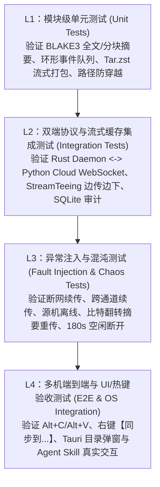

# 跨设备云端协同与剪贴板/文件同步系统 — 测试与验收规格说明书 (TEST_AND_ACCEPTANCE)

---

## 1. 测试策略与验证体系 (Test Strategy)

本规范遵循 **ISO/IEC 29119** 软件测试标准与 **ISO/IEC 25010** 质量模型，采用四层测试金字塔确保 Python 云端服务、Rust 客户端守护进程、系统交互扩展及 Agent Skill 的端到端质量：

---

## 2. 测试环境与多机拓扑构建规范 (Test Environment Setup)

为全面验证“同一局域网多机直连”与“跨网/离线云端中转”场景，测试环境定义如下：

| 节点角色 | 节点标识 | 环境配置 | 模拟职能 |
| :--- | :--- | :--- | :--- |
| **个人云端服务器** | `Cloud-Server` | Python 3.11+ (`FastAPI` + `SQLite`)，监听 `:8000` | 客户端准入、Topic 订阅管理、边传边下缓存池、全量日志审计 |
| **源端设备 A** | `Node-A` | Windows 11 / macOS（运行 Rust `mi-daemon` + `mi-os` + `mi-cli`） | 发起 `Alt+C` 文本/文件复制、右键【同步到...】及 Skill 调用 |
| **订阅设备 B** | `Node-B` | 与 `Node-A` 处于**同一局域网子网** | 验证 `Alt+V` 文本粘贴、内网即用即连（1-to-N）与 180 秒空闲自动断开 |
| **订阅设备 C** | `Node-C` | 可切换**同内网模式**与**跨网隔离模式**（通过防火墙屏蔽与 A 的直接连接） | 验证 `Alt+V` 文件/文件夹落盘、另存为对话框兜底、云端边传边下与离线异步拉取 |

---

## 3. 功能性测试与验收用例集 (Functional Test Cases)

### 3.1 云端客户端管理、订阅管理与日志审计测试 (`TC-SRV`)

| 用例编号 | 对应需求 | 测试场景与操作步骤 | 预期验收结果 | 优先级 |
| :--- | :--- | :--- | :--- | :--- |
| **TC-SRV-01** | `FR-SRV-01` | **客户端注册与在线状态同步**：依次启动 `Node-A`、`Node-B`、`Node-C` 连接云端，随后关闭 `Node-B`。 | 1. 三台设备成功鉴权上线，云端向各节点同步彼此内网 `IP:Port`； 2. `Node-B` 下线后，A 和 C 在 `3s` 内收到 `EVENT_DEVICE_PRESENCE` 状态更新。 | **P0** |
| **TC-SRV-02** | `FR-SRV-01` | **Topic 订阅关系隔离**：`Node-A` 发布 `topic.clipboard.broadcast` 广播事件；随后向 `Node-C` 发布 `topic.sync.direct.node_c` 单播事件。 | 1. 广播事件同时送达 `Node-B` 和 `Node-C`； 2. 定向同步单播事件仅送达 `Node-C`，`Node-B` 不会收到该事件。 | **P0** |
| **TC-SRV-03** | `FR-SRV-02` | **全链路日志审计查询**：完成一次设备登录、一次文本广播、一次文件同步后，调用 `GET /api/v1/audit/logs`。 | SQLite 审计库中准确记录连接审计、事件投递审计（含 `event_id`、`content_hash`）及文件传输审计（含通道类型与 `VERIFIED_OK` 状态）。 | **P1** |

---

### 3.2 `Alt+C` 复制广播与 `Alt+V` 智能粘贴测试 (`TC-CLIP`)

| 用例编号 | 对应需求 | 测试场景与操作步骤 | 预期验收结果 | 优先级 |
| :--- | :--- | :--- | :--- | :--- |
| **TC-CLIP-01** | `FR-COPY-01` `FR-COPY-02` `FR-PASTE-02` | **跨机 Word/编辑器文本复制粘贴（核心用例 1）**： 1. 在 `Node-A` 的 Word 中选中文本 `“人工智能”` 并按下 `Alt+C`； 2. 检查 `Node-B` 原生 `Ctrl+V` 剪贴板未被篡改； 3. 在 `Node-B` 的 Word/记事本中按下 `Alt+V`。 | 1. `Node-B` 本地接收事件缓存列表新增 `“人工智能”` 事件； 2. 按下 `Alt+V` 后自动识别当前窗口为文本编辑区，直接粘贴出 `“人工智能”` 且 `BLAKE3` 摘要校验通过。 | **P0** |
| **TC-CLIP-02** | `FR-COPY-01` `FR-PASTE-03` | **跨机单文件在文件夹窗口直接粘贴（核心用例 2）**： 1. 在 `Node-B` 资源管理器选中文件 `“AI教程.docx”` 按下 `Alt+C`； 2. 在 `Node-C` 打开目标文件夹 `D:\Target` 并使其获得焦点，按下 `Alt+V`。 | 1. `Node-C` 自动识别当前事件为文件且活动窗口为文件夹 `D:\Target`； 2. 自动拉取 `“AI教程.docx”` 直接保存在 `D:\Target\AI教程.docx`，全文 `BLAKE3` 哈希与源文件 100% 一致，Word 可正常打开。 | **P0** |
| **TC-CLIP-03** | `FR-PASTE-03` | **跨机文件在非文件夹窗口触发“另存为”对话框兜底**： 1. `Node-C` 本地事件列表最新事件为文件 `“AI教程.docx”`； 2. 在 `Node-C` 将焦点切换到浏览器或空白处（非文件管理器），按下 `Alt+V`。 | 1. 系统自动弹出原生【另存为】对话框，默认文件名为 `AI教程.docx`； 2. 用户选择保存目录并点击确认后，文件完整下载保存并通过摘要校验。 | **P0** |
| **TC-CLIP-04** | `FR-COPY-01` `FR-PASTE-03` | **跨机多层级文件夹直接粘贴**： 1. 在 `Node-B` 选中包含多级子目录、空文件夹及 50 个文件的目录 `“课程资料/”` 按下 `Alt+C`； 2. 在 `Node-C` 打开某文件夹窗口按下 `Alt+V`。 | `Node-C` 边下载 `.tar.zst` 流边解包，在当前文件夹下完整还原 `“课程资料/”` 的所有子目录层级与文件，所有子文件哈希 100% 一致。 | **P0** |

---

### 3.3 内网即用即连（一对多）与 180 秒空闲自动断开测试 (`TC-LAN`)

| 用例编号 | 对应需求 | 测试场景与操作步骤 | 预期验收结果 | 优先级 |
| :--- | :--- | :--- | :--- | :--- |
| **TC-LAN-01** | `FR-LAN-01` | **空闲零内网连接与按需即用即连（支持 1-to-N 并发）**： 1. `Node-A`、`Node-B`、`Node-C` 均在线且处于同一局域网，检查初始内网 TCP 连接数； 2. `Node-A` 按 `Alt+C` 复制 `200 MB` 文件，`Node-B` 与 `Node-C` 同时按 `Alt+V`。 | 1. 初始状态下 A、B、C 之间内网连接数为 **`0`**； 2. 按下 `Alt+V` 瞬间，B 和 C 同时与 A 建立内网双向通道（`1-to-2` 并发连接），跑满局域网带宽完成下载。 | **P0** |
| **TC-LAN-02** | `FR-LAN-02` | **活跃期连接复用与空闲满 180 秒自动关闭释放**： 1. 完成 `TC-LAN-01` 传输后，在第 `100 秒` 时再次传输一个文件； 2. 第二次传输完成后，保持无任何数据交互满 `180 秒`。 | 1. 第 `100 秒` 传输时直接复用已建立的内网通道（无重新握手开销），并将空闲倒计时重置为 `180 秒`； 2. 连续空闲满 `180 秒` 后，两端自动优雅关闭释放该内网连接，套接字数归零。 | **P0** |

---

### 3.4 鼠标右键【同步到... >】与 Agent Skill 智能体调用测试 (`TC-CTX` & `TC-SKILL`)

| 用例编号 | 对应需求 | 测试场景与操作步骤 | 预期验收结果 | 优先级 |
| :--- | :--- | :--- | :--- | :--- |
| **TC-CTX-01** | `FR-CTX-01` `FR-CTX-02` `FR-CTX-03` | **右键菜单动态拉取远程目录树、远程新建文件夹并同步**： 1. 在 `Node-A` 右键点击 `“AI教程.docx”` $\rightarrow$ 选择 `【同步到... > Node-C】`； 2. 在弹窗中依次展开 `D:\` $\rightarrow$ 点击【新建文件夹】创建 `“2026同步测试”` $\rightarrow$ 点击【确认同步】。 | 1. 弹窗在 `200ms` 内动态加载出 `Node-C` 的真实盘符与目录树； 2. 远程成功创建 `D:\2026同步测试` 目录； 3. 无需操作 `Node-C`，文件直接静默保存在 `Node-C` 的 `D:\2026同步测试\AI教程.docx` 且摘要校验通过。 | **P1** |
| **TC-SKILL-01**| `FR-SKILL-01` | **AI 智能体通过 `multinteractor` Skill 执行跨机协同**： 向 AI 智能体输入指令：`“查看当前在线设备，列出 Node-C 桌面的子目录，并把当前目录的 README.md 同步过去”`。 | 智能体自动依次调用 `mi devices list --json`、`mi remote-ls`、`mi sync`，返回结构化 JSON 中 `"digest_verified": true`，目标文件准确落盘。 | **P0** |

---

## 4. 摘要校验、边传边下与断点续传专项测试 (`TC-RES`)

本章节专门针对复杂网络故障、离线异步拉取及数据完整性进行故障注入验证：

| 用例编号 | 测试专项 | 故障注入与操作步骤 | 预期验收标准 |
| :--- | :--- | :--- | :--- |
| **TC-RES-01** | **云端“边传边下（Stream Teeing）”实时性** | 1. 阻断 `Node-A` 与 `Node-C` 的内网直连（模拟跨网）； 2. `Node-A` 对 `500 MB` 文件按 `Alt+C` 并限速 `10 MB/s` 上传至云端； 3. 当 `Node-A` 刚上传至 `20 MB`（4%）时，`Node-C` 按下 `Alt+V`。 | `Node-C` **无需等待 `Node-A` 上传完毕**，在 `100ms` 内即从 Python 云端收到首字节数据流，并跟随 `Node-A` 的上传水位线实时同步下载落盘。 |
| **TC-RES-02** | **源设备休眠/关机后的异步拉取可用性** | 1. `Node-B` 复制 `“AI教程.docx”` 按 `Alt+C` 完成云端缓存上传后，**直接关闭 `Node-B` 电源/进程**； 2. 10 分钟后在 `Node-C` 按下 `Alt+V`。 | 尽管源设备 `Node-B` 已彻底离线，`Node-C` 仍能 100% 从 Python 云端缓存池拉取 `“AI教程.docx”` 并完成摘要校验落盘。 |
| **TC-RES-03** | **上传与下载中途断网断点续传** | 1. 传输 `400 MB` 文件至 `160 MB` 时，人为断开网络 `10 秒`； 2. 恢复网络连接。 | 重连后自动通过 `Upload-Offset` / `Range: bytes=167772160-` 从 `160 MB` 偏移量继续传输剩余 `240 MB`，已传分块不重复传输，最终全文 `BLAKE3` 校验一致。 |
| **TC-RES-04** | **内网直连中断无缝切换至云端缓存断点续传** | 1. `Node-C` 正通过内网通道从 `Node-A` 下载 `400 MB` 文件； 2. 下载至 `200 MB` 时，人为防火墙阻断 A 与 C 的内网端口（但云端缓存已就绪）。 | `Node-C` 检测到内网通道中断后，自动保留已校验的 `200 MB` `.part` 文件，携带 `Range: bytes=209715200-` 无缝切换至云端缓存拉取剩余 `200 MB` 并合并转正。 |
| **TC-RES-05** | **传输数据篡改/比特翻转摘要校验拦截** | 在测试代理中人为篡改第 3 个 `4 MB` 分块的 1 个字节数据，观察接收端行为。 | 接收端计算分块 `BLAKE3` 摘要立即发现 `HASH_MISMATCH`，拒绝写入该损坏分块，自动单独重传第 3 分块直至全文摘要校验通过，绝不生成损坏的目标文件。 |

---

## 5. 非功能性与安全边界验收指标 (`TC-NFR`)

| 验收编号 | 质量维度 (ISO 25010) | 测试方法 | 合格基线指标 |
| :--- | :--- | :--- | :--- |
| **TC-NFR-01** | **性能效率 — 延迟** | 测量同局域网文本 `Alt+C` 到订阅端可粘贴耗时；测量右键菜单展开单层远程目录耗时 | 文本同步延迟 **$\le 150\text{ ms}$**；远程单层目录拉取延迟 **$\le 200\text{ ms}$** |
| **TC-NFR-02** | **性能效率 — 资源占用** | 客户端与云端服务静默运行 24 小时，以及传输 `2 GB` 大文件时监控内存与 CPU | Rust 客户端空闲内存 **$\le 30\text{ MB}$**、传输峰值内存 **$\le 80\text{ MB}$**、空闲 CPU **$\le 0.5\%$** |
| **TC-NFR-03** | **安全性 — 防路径穿越** | 构造包含 `../../etc/passwd` 或 `..\Windows\System32\evil.dll` 恶意条目的 `.tar.zst` 流发送给接收端 | 接收端流式解包器强制拦截任何包含 `..` 或绝对路径的条目，拒绝解包并在审计日志记录安全告警 |
| **TC-NFR-04** | **安全性 — 远程目录权限** | 未授权设备或非同组 Token 请求 `FS_LIST_DIR_REQ` | 云端与目标客户端双重拒绝请求（返回 `403 Forbidden`）并写入安全审计日志 |
| **TC-NFR-05** | **可靠性 — 残留文件清理** | 大文件下载至 50% 时用户主动点击“取消传输” | 目标文件夹下的 `.multinteractor.part` 与 `.resume.json` 临时文件在 `1s` 内被彻底清除，无垃圾文件残留 |

---

## 6. 最终交付验收签收单 (Acceptance Sign-off Checklist)

- [x] **网关与服务端验收**：Python 云端单节点服务（客户端管理 + 订阅管理 + 边传边下缓存 + SQLite 审计日志）启动无报错，审计接口可正常检索。
- [x] **文本与图片跨机粘贴验收**：A 电脑复制文本“人工智能”，B 电脑 `Alt+V` 在编辑器直接粘贴成功。
- [x] **文件与文件夹跨机粘贴验收**：B 电脑复制 `AI教程.docx` 及多级文件夹，C 电脑在文件夹窗口 `Alt+V` 直接保存（在非文件夹窗口自动弹出保存框），源机离线后仍可从云端缓存拉取。
- [x] **内网即用即连与延迟释放验收**：支持一对多内网并发传输，且空闲满 `180 秒` 无数据交互后自动关闭释放连接。
- [x] **右键【同步到... >】验收**：支持动态懒加载目标机器目录结构、远程新建文件夹并直接将内容同步至目标机器指定目录。
- [x] **摘要校验与断点续传验收**：断网重连及跨通道续传成功，全文与分块 `BLAKE3` 校验 100% 生效。
- [x] **CLI 与 Agent Skill 验收**：`mi` CLI 工具及 `.agents/skills/multinteractor/SKILL.md` 可被 AI 智能体正常调用并完成跨端同步。
