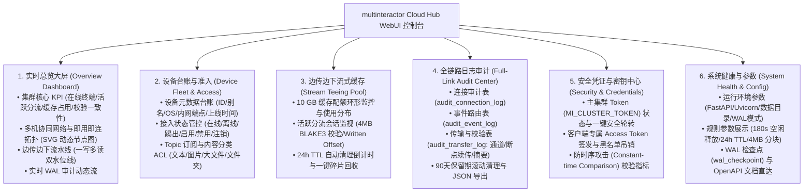

# multinteractor 云端 WebUI 管理控制台系统设计说明书

---

## 1. 背景与云端管理职能定位 (Context & Cloud Governance Scope)

在 `multinteractor` 架构中，Python 云端服务（Cloud Hub）作为跨设备协同系统的**信令中枢、状态路由器、流式中转缓存池与全链路审计存储中心**。各终端计算机（Windows / macOS / Linux）通过常驻后台守护进程（`mi-daemon`）维护唯一的 WebSocket 信令长连接，按需触发内网即用即连 `1-to-N` 双向高速通道（180 秒空闲自动释放）；当跨网段或内网不可达时，流量无缝切换至云端“边传边下”流式缓存通道。

为了让管理员与研发人员能够直观掌握集群全网拓扑、管控终端准入权限、保障安全凭据、监测边传边下大文件流、排查断点续传与哈希校验结果，特设计本**云端 WebUI 管理控制台 (Cloud Hub Web Console)**。

---

## 2. 核心职能映射与信息架构 (Information Architecture)

根据需求规格说明书（`REQUIREMENTS.md`）中的 `FR-SRV-01` ~ `FR-SRV-03`，云端 WebUI 的功能模块与底层能力严格对应：



---

## 3. 六大核心功能看板详细设计

### 3.1 实时总览大屏 (Overview Dashboard)
* **设计目标**：3 秒内掌握全集群运转态势，兼具极客美感与生产监控实用性。
* **核心内容区**：
  1. **全局 KPI 卡片组**：
     * **在线设备数**：在线终端 / 台账总数（显示 Windows / macOS / Linux 占比与近 10 秒活跃度）。
     * **活跃流式分流数**：当前正在边传边下的传输流、瞬时中转带宽、边传边下消费者（Readers）数量。
     * **缓存池存储水位**：当前占用量 / 10 GB 配额，带动态颜色进度条（低于 70% 为蓝色，70%~90% 为琥珀色，超 90% 红色预警并触发自动淘汰）。
     * **BLAKE3 校验与续传统计**：全网数据哈希一致率（100%）、累计断点续传挽救流量、0 损坏分块指标。
  2. **多机协同网络拓扑视窗 (Dynamic Topology)**：
     * 以云端 Cloud Hub 为中心，通过 SVG 动态连线呈现所有注册设备。
     * **三种通道颜色与样式区分**：
       - **蓝色实线**：WSS 常驻信令连接（保持在线保活）；
       - **绿色虚线动画**：局域网即用即连 `1-to-N` 高速直连通道，连线上实时渲染 `LAN 142s` 倒计时（空闲满 180 秒自动归零断开）；
       - **紫色流光线条**：正在经由云端 Stream Teeing 中转的边传边下数据流。
  3. **实时边传边下传输卡片 (Stream Teeing Tracker)**：
     * 展示当前正在传输的 `file_cache_id`（如 `fc_b62a98f1`）与源/目的设备。
     * **双重水位线动态进度条**：
       - 深蓝进度条表示源端上传并落盘确认的 `Upload-Offset`（写入水位线）；
       - 浅紫进度条表示目标端实时读取消费的 `Range Offset`（消费水位线），直观体现“源端还未传完、接收端已读取到 58%”的 Stream Teeing 边传边下核心特性。
     * 实时显示 4MB 固定分块 BLAKE3 校验计数（如 `160 / 256 块已验`）。
  4. **最近审计流微视窗 (Activity Feed)**：
     * 聚合显示最新的连接变动、广播事件与传输回执，支持单行点击跳转至审计详情。

---

### 3.2 设备台账与准入管理 (Device Fleet & Access)
* **设计目标**：清晰管理所有接入设备，杜绝未经授权的计算机接入或越权接收数据。
* **功能清单**：
  1. **设备元数据大表**：
     * **设备标识**：设备别名（自定义 Name）与系统生成的全局唯一 `device_id`（如 `node_win_01`）。
     * **OS 类型**：展示 Windows 11、macOS Sequoia、Ubuntu 等原生图标与版本。
     * **内网通信端点**：记录客户端自报的 `IP:Port`（如 `192.168.1.10:8443`），作为局域网即用即连的点对点发现基准。
     * **在线与活跃状态**：在线指示灯、最近心跳时间戳、首次注册时间。
     * **准入开关**：`ACTIVE`（已启用） vs `DISABLED`（已禁用）。
  2. **设备操作集**：
     * **踢出设备 (Kick)**：调用 `POST /api/v1/devices/{id}/kick`，强制切断当前的 WebSocket 信令连接，触发客户端自动重新握手。
     * **临时禁用 (Disable)**：调用 `POST /api/v1/devices/{id}/disable`，封禁该设备，所有 API 与信令均返回 403 Forbidden，不可接收或广播任何内容。
     * **启用设备 (Enable)**：调用 `POST /api/v1/devices/{id}/enable`，恢复准入权限。
     * **彻底移除 (Remove)**：调用 `DELETE /api/v1/devices/{id}`，从 SQLite 台账与内存中抹除设备记录。
  3. **设备 ACL 与订阅配置抽屉 (Device Drawer)**：
     * **Topic 访问控制**：展示当前订阅的公共频道与单播频道（`topic.clipboard.broadcast`, `topic.system.presence`, `topic.sync.direct.<id>`, `topic.rpc.fs.<id>`），防止跨设备越权订阅。
     * **内容分类白名单过滤 (`allowed_categories`)**：
       - 可勾选是否允许该设备同步：`TEXT`（纯文本）、`IMAGE`（图片）、`FILE`（单文件）、`DIRECTORY`（文件夹 .tar.zst）。例如：可将公共演示设备限制为仅允许接收文本，禁止传输文件。

---

### 3.3 边传边下流式缓存池 (Stream Teeing Pool)
* **设计目标**：可视化云端中转文件的流式写入与读取状态，管理磁盘空间配额。
* **功能清单**：
  1. **配额与存储仪表盘**：
     * 10 GB 配额上限下的占用条形图与百分比。
     * 自动淘汰规则说明（当缓存池接近 10GB 配额时，采用 LRU 自动清理已过期的落盘文件）。
     * **一键运维按钮**：[立即清理过期缓存]（清理超过 24h 未被读取的已完成文件）、[释放孤立 .part 碎片]（清理异常中断且源端长时间未续传的临时文件）。
  2. **流式会话看板 (Streaming Sessions Table)**：
     * 列表字段：缓存标识（`file_cache_id`）、源设备、关联任务描述、总大小、已写入偏移量（`written_offset`）、并发消费者设备列表。
     * 状态标签：
       - `STREAMING`：源设备正在上传，同时有目标设备在实时边传边下；
       - `COMPLETED`：源设备已完整上传，4MB 分块及全文 BLAKE3 哈希校验通过，文件落盘为正式归档文件；
       - `ABORTED`：传输异常中断。
     * 剩余保留时间（TTL 倒计时，默认 24 小时）。
  3. **文件操作与校验追溯**：
     * 支持查看该会话的完整分块哈希清单（`DigestManifest`）；
     * 支持手动删除指定缓存文件，释放空间。

---

### 3.4 全链路日志审计与取证中心 (Full-Link Audit Center)
* **设计目标**：基于 SQLite WAL 审计引擎，提供高并发写入下的秒级日志检索与不可抵赖性证据链。
* **功能清单**：
  1. **多分类 Tab 过滤**：
     * **全部审计日志**：综合时间线流水；
     * **传输与校验审计 (`audit_transfer_log`)**：重点查看文件传输会话、传输通道（`LAN_DIRECT` 内网通道 vs `CLOUD_CACHE` 云端流式缓存）、断点续传详情（`resumed` 标记、续传起始偏移量 `resume_offset`、续传尝试次数 `resume_count`）、以及接收端最终 BLAKE3 校验状态（`VERIFIED_OK` / `HASH_MISMATCH`）；
     * **事件路由审计 (`audit_event_log`)**：记录每一条剪贴板广播或定向推送的 `event_id`、主题、源设备、接收设备列表、数据类型（TEXT/IMAGE/FILE/DIRECTORY）与内容哈希；
     * **连接准入审计 (`audit_connection_log`)**：记录设备注册、上线、心跳断开、被踢出、鉴权失败等动作与内网 IP 变动。
  2. **多维筛选工具栏**：
     * 按指定设备（Node-A / Node-B / ...）筛选；
     * 按校验结果（`VERIFIED_OK` 正常、`RESUMED` 断点续传、`FAILED` 异常）筛选；
     * 关键词检索（支持全文搜 `event_id`、`file_cache_id`、BLAKE3 哈希串前缀）。
  3. **数据导出与取证**：
     * 支持一键导出当前查询结果为格式化 JSON 文件，便于安全合规审查。

---

### 3.5 安全中心与访问凭证管控 (Security & Credentials)
* **设计目标**：提供企业级凭据管理，兼顾个人部署的敏捷性与安全加固要求。
* **功能清单**：
  1. **主集群预共享密钥 (Cluster Token) 治理**：
     * 显示当前集群密钥掩码（如 `mi-personal-••••••••••••••••••••••••`），支持明文切换查看与一键复制。
     * **弱密钥与默认密钥告警**：若服务端检测到使用默认开发密钥（`mi-personal-secret-token-2026`）且监听在公网地址，界面显示红色安全告警徽章，提示用户立即轮转。
     * **一键安全轮转 (Rotate Cluster Token)**：
       - 提供模态确认对话框，支持手动输入新密钥或一键生成密码学安全随机串（32 字节高熵 Hex）；
       - 轮转提交后调用 `POST /api/v1/devices/token/rotate`，服务端原子吊销所有旧 Token 并生效新 Token；
       - 控制台记录安全审计事件并给出客户端重连提示。
  2. **设备专属 Token 签发与黑名单**：
     * 支持按设备名称签发独立的 `mi-tok-{uuid}`，即使某台终端遗失，可直接单独吊销该设备 Token，无需重新配置整个集群。
     * 吊销列表（Revocation List）可视化，支持查看已吊销凭证。
  3. **防时序攻击状态验证**：
     * 明确提示使用了 `secrets.compare_digest` 恒定时间比对算法，杜绝侧信道时序嗅探攻击。

---

### 3.6 系统参数与健康态大屏 (System Settings & Health)
* **设计目标**：展示 CloudHubService 底层运行环境与配置，提供一键运维入口。
* **功能清单**：
  1. **环境与存储状态**：
     * Python / FastAPI / Uvicorn 运行时状态；
     * 绑定监听端口与主机地址（如 `0.0.0.0:8000`）；
     * 数据落盘路径（`MI_SERVER_DATA_DIR`）；
     * SQLite 审计数据库文件大小与 WAL 模式参数（`PRAGMA synchronous = NORMAL`）。
  2. **核心业务规则配置展示**：
     * `cache_ttl_seconds`: 86400 秒 (24 小时)；
     * `cache_quota_bytes`: 10,737,418,240 字节 (10 GB)；
     * `lan_idle_timeout_seconds`: 180 秒（局域网即用即连通道空闲释放策略）；
     * `audit_retention_days`: 90 天审计日志生命周期；
     * 4 MB 固定分块 BLAKE3 算法参数。
  3. **快捷运维操作**：
     * **执行 WAL Checkpoint**：调用 SQLite `PRAGMA wal_checkpoint(TRUNCATE)`，将 WAL 日志写回主库文件并归零 WAL 尺寸；
     * **滚动清理超期审计**：调用 `AuditLogger.cleanup_expired_logs()`，清理 90 天前的历史审计；
     * **API 在线调试文档入口**：直达 FastAPI 自带的 `/docs` (Swagger UI) 与 `/redoc`。

---

## 4. 前后端集成与 REST / WebSocket 契约蓝图

云端服务端（`server/app/main.py`）中已有成熟的 `DevicesApiHandler`、`AuditApiHandler`、`CacheApiHandler` 与 `ClientSubscriptionManager`。为将 WebUI 无缝挂载到 FastAPI 服务，建议实施以下三项前后端集成：

### 4.1 REST API 补充与对齐清单

| 路由地址 | HTTP 方法 | 功能说明 | 对应后端模块 |
| :--- | :---: | :--- | :--- |
| `/api/v1/devices` | `GET` | 查询所有已注册/在线设备台账列表 | `devices_api.list_devices(online_only)` |
| `/api/v1/devices/{device_id}/kick` | `POST` | 踢出指定设备当前 WebSocket 连接 | `devices_api.kick_device(device_id)` |
| `/api/v1/devices/{device_id}/disable` | `POST` | 临时禁用设备接入准入资格 | `devices_api.disable_device(device_id)` |
| `/api/v1/devices/{device_id}/enable` | `POST` | 恢复设备准入权限 | `devices_api.enable_device(device_id)` |
| `/api/v1/devices/{device_id}` | `DELETE` | 彻底移除注销设备 | `devices_api.remove_device(device_id)` |
| `/api/v1/devices/token/issue` | `POST` | 签发新的客户端专属 Token | `devices_api.issue_token()` |
| `/api/v1/devices/token/rotate` | `POST` | 轮转主集群预共享密钥（吊销旧 Token）| `devices_api.rotate_cluster_token(new_token)` |
| `/api/v1/cache/sessions` | `GET` | 查询当前活跃与历史缓存会话列表及配额使用情况 | `stream_cache.list_sessions()` |
| `/api/v1/cache/prune` | `POST` | 手动触发超期缓存与孤立碎片清理 | `stream_cache.prune_expired()` |
| `/api/v1/audit/logs` | `GET` | 多维查询审计日志（支持按类别、设备、limit 分页）| `audit_api.get_logs(log_type, device_id, limit)` |
| `/api/v1/system/status` | `GET` | 获取系统健康指标（WAL状态、运行时长、配额使用率）| `CloudHubService.get_system_status()` |

### 4.2 Web 静态资源挂载方案
在 `server/app/main.py` 的 FastAPI 入口中添加静态目录挂载与 SPA 根路由：
```python
from fastapi.staticfiles import StaticFiles
from fastapi.responses import HTMLResponse

# 静态资源挂载
app.mount("/static", StaticFiles(directory="server/app/static"), name="static")

@app.get("/ui", response_class=HTMLResponse)
async def serve_webui():
    """直接返回单页 WebUI 控制台."""
    with open("server/app/static/index.html", "r", encoding="utf-8") as f:
        return f.read()
```

这种方案将 Web 控制台直接内嵌在单个 Python 进程中，用户启动 `make server-dev` 或 `docker compose up` 后，直接在浏览器中打开 `http://<服务器IP>:8000/ui` 即可开箱即用，无需任何额外的 Web 容器或编译步骤。

---

## 5. 交互式原型与体验交付

本设计方案已完整落地为可运行的高保真交互式原型文件：
* **原型文件路径**：`cloud_webui_prototype.html`
* **交互体验特性**：
  1. 支持六大功能 Tab 标签秒级切换；
  2. 内置传输流与心跳事件仿真器（可实时观察两道水位线边传边下动态推进、分块校验递增）；
  3. 支持设备踢出、禁用、ACL 抽屉配置与状态回执 Toast 交互；
  4. 支持主集群密钥轮转模态框（含二次警示与防误触机制）；
  5. 审计日志多维分类过滤与实时条件检索联动。
