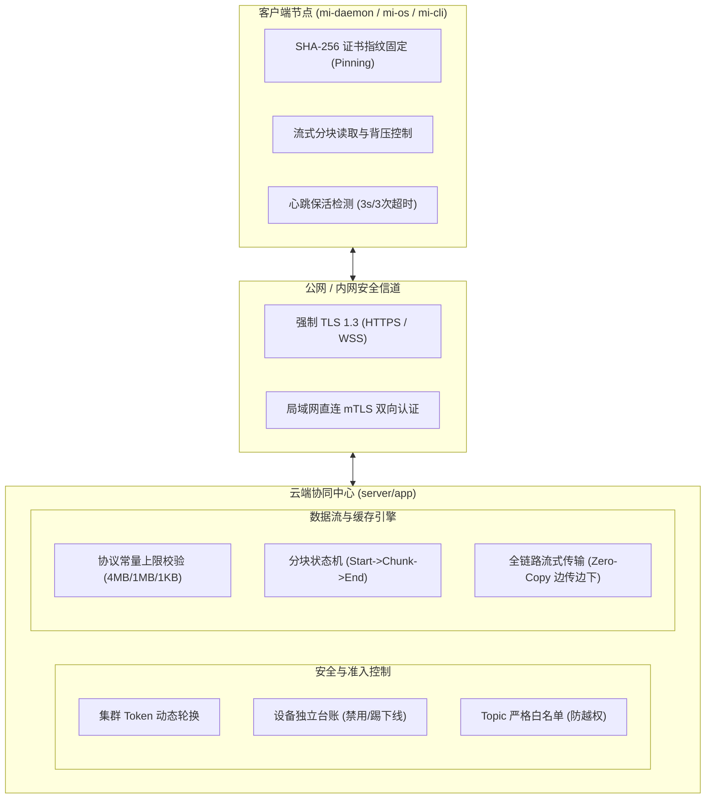

# 跨设备数据协同系统（multinteractor）技术设计优化与安全加固规范

---

## 1. 架构目标与设计原则

针对系统在公网环境部署、跨广域网协同、大文件分块流式传输以及单人多设备管理的安全诉求，本规范确立以下五大核心技术设计原则：

1. **公网传输强制加密与轻量证书信任（Zero-Trust Public Transport）**：
   - 彻底废除明文传输，信令与数据通道全量走 TLS 1.3 / 1.2；
   - 引入 SHA-256 证书指纹固定（Certificate Pinning），允许自签免商业 CA 依然杜绝中间人劫持（MITM）。
2. **协议边界前置防御与显式分块状态机（Defensive Boundary & Explicit FSM）**：
   - 严格在协议解码第一线执行配额与长度硬上限校验，防止内存放大与缓冲区溢出；
   - 传输采用 Start $\rightarrow$ Chunk $\rightarrow$ End 严格状态机流转，声明先行，超限即拒。
3. **全链路零拷贝流式背压（Streaming & Backpressure）**：
   - 消除一次性载入大文件内存的非流式操作，服务端使用 `StreamingResponse` 配合分块水位线出流；
   - 消息总线收件箱设置有界缓冲与过载丢弃策略，保障内存平稳。
4. **双层身份准入与设备全生命周期控制（Two-Tier Access & Device Lifecycle）**：
   - 集群 Token 支持一键动态轮换（Token Rotation），旧 Token 立即作废；
   - 建立设备独立台账，支持单设备禁用、强制踢下线与彻底删除；Topic 订阅严格执行最小权限白名单（ACL）。
5. **主动探活与即用即连生命周期管理（Active Liveness & On-Demand Lifecycle）**：
   - 云端信令双向 Ping-Pong 毫秒级探测；内网 P2P 通道即用即连并在 180 秒无数据交互后自动优雅关闭。

---

## 2. 系统核心技术优化设计方案



### 2.1 传输层与公网信道加固方案（TLS + 证书指纹固定）

由于服务端部署于公网，客户端跨不同网络环境接入，系统必须杜绝任何公网明文传输，同时降低对商业 CA 证书的强依赖。

#### 2.1.1 服务端 TLS 强制约束
* 服务端 WebSocket 信令网关（`/ws/signaling`）与 REST 缓存接口（`/api/v1/*`）统一强制启用 TLS 1.3（向下兼容 TLS 1.2）。
* 废弃所有不安全的加密套件，强制使用 AEAD 密码套件（如 `TLS_AES_256_GCM_SHA384`、`TLS_CHACHA20_POLY1305_SHA256`）。

#### 2.1.2 客户端证书指纹固定（SHA-256 Fingerprint Pinning）
* **机制设计**：对于个人自建服务器或无公网可信 CA 证书的场景，客户端配置文件中增加 `server_cert_sha256` 配置项。
* **校验逻辑**：客户端建立 TLS 握手时，通过底层回调提取服务端终端实体证书的原始 DER 编码并计算 SHA-256 摘要：
  - 若配置了指纹，必须与本地配置的指纹严格字符串匹配；若指纹不一致，立即阻断连接（抛出 `TlsFingerprintMismatch` 错误）。
  - 该机制允许在公网使用自签名证书且免疫任何中间人劫持（MITM）与伪造 CA 攻击。

#### 2.1.3 内网即用即连通道的 mTLS 双向认证
* 设备间在局域网协商建立 P2P 直连通道时，双方各自生成本地临时证书并在云端握手帧中同步自身公钥指纹。
* 内网直连建立时强制执行基于指纹的双向 TLS（mTLS）握手，杜绝同一局域网内其他恶意终端假冒内网端点窃取或注入数据。

---

### 2.2 协议防御式边界与分块状态机方案

将防御逻辑前置到协议解码与数据接收的最早阶段，防止恶意构造的数据包引发服务端/客户端内存耗尽（DoS）或磁盘溢出。

#### 2.2.1 集中式协议上限常量（Defensive Protocol Limits）
在协议模型中统一定义全局硬性上限常量，双端强制执行：

| 常量名称 | 取值 | 作用与防御目标 |
| :--- | :--- | :--- |
| `MAX_HELLO_FRAME_SIZE` | 1 KB (1024 B) | 限制握手与注册帧大小，防止握手阶段消耗过多解析资源 |
| `MAX_INLINE_DATA_SIZE` | 1 MB | 限制剪贴板文本与元数据内联载荷大小，超限强制转文件流 |
| `MAX_CHUNK_SIZE` | 4 MB | 限制单个传输分块（Chunk）的最大物理大小 |
| `MAX_TRANSFER_TOTAL_SIZE` | 100 GB | 单个传输任务最大声明尺寸，超过配额直接在 Start 阶段拦截 |
| `MAX_PATH_LENGTH` | 1024 B | 限制 RPC 路径与文件名长度，防范深层嵌套与缓冲区溢出 |

#### 2.2.2 分块流传输严格状态机（Start $\rightarrow$ Chunk $\rightarrow$ End）
传输生命周期采用显式状态机流转：

```text
[Init/Start] ──(校验总长与配额)──> [Started] ──(连续块写入)──> [InProgress] ──(接收完毕)──> [Completed]
      │                               │
      └──(超限/配额不足)──> [Rejected]  └──(单块哈希不符)──> [Discard/Retry]
```

1. **Start 阶段（声明先行）**：
   - 上传或接收前先发送元数据帧（声明 `file_cache_id`、`total_size` 与 `DigestManifest`）。
   - **配额前置检查**：检查 `total_size` 是否超过系统单任务配额及云端剩余磁盘配额；超标直接进入 `Rejected` 状态，返回 HTTP 413，**严禁提前创建本地 `.part` 临时文件**。
2. **Chunk 阶段（边界与分块摘要双重校验）**：
   - 写入边界校验：断言 `upload_offset + len(chunk_data) <= total_size`，禁止超出声明大小的溢出写入。
   - 分块摘要校验：每块传输必须携带该块的 BLAKE3 摘要，与 `DigestManifest.chunk_hashes[i]` 比对。校验失败立即丢弃该块并返回错误，不推进已确认偏移量。
3. **End 阶段（全文转正原子化）**：
   - 仅当已写入字节数严格等于 `total_size` 时允许进入结算。
   - 执行全文 BLAKE3 校验，通过后通过文件系统原子重命名（`rename`）转正，杜绝残损文件落盘。

---

### 2.3 内存防护与全链路流式背压方案

彻底消除一次性将整个文件或剪贴板载荷读入内存的非流式操作，防止在百兆/吉字节文件并发传输时触发 OOM。

#### 2.3.1 云端边传边下流式管道（Stream Piping）
* **服务端改造**：
  - 弃用全量拼接字节的 `read_range_bytes`，全面转用 `StreamingResponse` 与异步字节生成器 `stream_range`。
  - 读取时使用固定大小缓冲区（如 64 KB），根据当前已落盘水位线 `written_offset` 流式出流。
* **流式哈希计算**：
  - Python 与 Rust 的摘要计算组件全面改造为流式增量计算（`hasher.update(chunk)`），严禁使用 `read_bytes()` 读取大文件。

#### 2.3.2 有界缓冲队列与慢消费者背压策略
* **客户端接收收件箱**：将 `RegisteredDevice.inbox` 的无界 `asyncio.Queue` 设定固定容量（`maxsize=500`）。
* **背压与淘汰策略**：
  - 当某设备网络卡顿或挂起导致队列满时，广播类消息采用“丢弃最旧数据（Drop Oldest）”策略，记录日志并发出背压告警。
  - 单播 RPC/文件通知类消息，若重试超时则将该设备标记为离线并切断连接，防止单个异常节点拖垮服务端事件总线。

---

### 2.4 双层身份准入与设备全生命周期管控方案

针对单人使用、公网暴露、Token 存在泄露风险的场景，建立“集群密钥 + 独立设备台账”双层安全体系。

```text
客户端连接请求
  ├── 1. 验证集群准入 Token (Token 必须未被吊销且处于激活状态)
  └── 2. 检查设备注册台账 (device_id 必须在已授权列表且 enabled == true)
       ├── 通过 -> 允许握手，绑定连接 Session
       └── 失败 -> 记录审计日志，立即切断网络连接
```

#### 2.4.1 集群准入密钥动态轮换（Token Rotation）
* 系统废除硬编码弱默认密钥，统一由环境变量 `MI_CLUSTER_TOKEN` 配置。
* 服务端管理接口支持 `POST /api/v1/auth/rotate-token`：
  - 生成高强度加密随机 Token（32 字节 Hex）；
  - 将旧 Token 自动归入作废集合（`revoked_tokens`），旧客户端下次重新握手时直接拒绝；
  - 采用常量时间字符串比对（`secrets.compare_digest`），防范时序侧信道攻击。

#### 2.4.2 设备独立台账与主动吊销（Device Revocation & Kick-off）
* 设备首次上线握手时，在服务端 SQLite 数据库中持久化记录设备元数据（`device_id`、设备别名、首次/最后活跃时间、启用状态）。
* 提供管理员设备控制接口：
  - **禁用设备（Disable）**：将设备状态置为 `enabled = false`。
  - **踢下线（Kick）**：若该设备当前在线，立即主动关闭其 WebSocket 连接，从订阅路由表中剔除。
  - **删除登记（Remove）**：彻底清除其台账数据。当设备被盗或外借时，即使用户尚未轮换 Cluster Token，被吊销的设备也无法再次连入。

#### 2.4.3 严格 Topic 订阅访问控制（Topic ACL）
* 限制客户端仅允许订阅以下三类 Topic：
  1. 公共广播通道：`clip.broadcast`、`sys.presence`；
  2. 自身单播接收通道：`sync.direct.{own_device_id}`；
  3. 自身文件 RPC 接收通道：`rpc.fs.{own_device_id}`。
* 服务端在客户端请求订阅时做白名单校验，严禁设备订阅其他节点的单播 Topic，彻底防止跨端监听与文件浏览越权。

---

### 2.5 连接生命周期管理与主动探活机制

提升对网络抖动、异常掉电及僵死连接的感知时效性，保证节点上下线状态准确。

#### 2.5.1 双向 Keep-Alive 保活心跳
* **信令长连接**：
  - 服务端每隔 3 秒向各在线客户端发送轻量级探活 Ping 帧；
  - 客户端收到后必须立即回应 Pong 帧；
  - 连续 3 次（即 9 秒）未收到 Pong 回应，服务端判定该连接死锁或断线，主动关闭底层 TCP 套接字并广播该设备 `OFFLINE` 事件。

#### 2.5.2 内网通道即用即连与空闲释放
* 客户端内网双向通道池（`LanChannelPool`）维持“平时零常驻连接”原则。
* 当触发定向同步或远程目录浏览时按需建立通道；每次数据 I/O 刷新最后活跃时间戳。
* 独立轮询线程每 10 秒扫描一次通道池，对连续空闲满 180 秒的通道执行优雅关闭并释放系统句柄。

---

## 3. 落地实施与修改路线图

### 阶段一：P0 协议边界防御与服务端核心安全加固
1. 在 `server/app/config.py` 中统一 Token 配置项为 `MI_CLUSTER_TOKEN`，增加默认弱密钥公网启动告警与 `secrets.compare_digest`。
2. 在 `server/app/models.py` 中增加协议硬性上限常量。
3. 修改 `server/app/stream_tee_cache.py`：
   - 对 `file_cache_id` 执行正则表达式白名单及 `cache_dir` 边界路径强校验；
   - 在 `append_chunk` 中断言边界，单块超过 4MB 或超出总长立即拒收并中断会话；
   - 实现服务启动加载本地现有 `*.meta.json` 恢复缓存会话；
   - 激活定时任务调用 `cleanup_expired_and_quota()`。
4. 修改 `server/app/client_sub_manager.py` 与 `api/devices.py`：
   - 落地设备禁用（`disable_device`）、删除（`remove_device`）与主动踢下线逻辑；
   - 限制 `extra_topics` 只能订阅自身单播与公共广播 Topic；
   - 替换 `_broadcast_presence` 字符串拼接为安全的 `json.dumps`；
   - 设置 `RegisteredDevice.inbox` 容量上限为 500。

### 阶段二：P0 客户端安全防御加固
1. 修改 `client/crates/mi-daemon/src/transfer/archive.rs`：
   - 拦截包含绝对路径、驱动器盘符、`..` 相对路径以及任何符号链接（Symlink）、硬链接（Hardlink）的恶意条目；
   - 限制解压总大小防压缩炸弹。
2. 修改 `client/crates/mi-daemon/src/transfer/downloader.rs`：
   - 恢复续传前核验 `file_cache_id` 与摘要清单匹配度；
   - 最终落盘验证改为增量流式验证。
3. 修改 `client/crates/mi-daemon/src/fs_rpc.rs`：
   - 增加客户端本地允许浏览的目录白名单，禁止无限制遍历系统根目录。

### 阶段三：P1 网络通信栈与公网 TLS 指纹固定落地
1. 完善服务端 ASGI/FastAPI 入口，建立真正的 WebSocket 端点与 HTTP 流式接口（`StreamingResponse`）。
2. 客户端引入 `tokio-tungstenite` 与 `reqwest`，接入服务端 TLS 通信通道。
3. 客户端实现自定义证书校验器：比对公钥证书 SHA-256 指纹与配置项 `server_cert_sha256`。
4. 落地客户端信令心跳与断网自动重连。
